# FileSanitizer

> **"Don't trust the file. Wash it first."**

[](https://github.com/jozeta/FileSanitizer/releases)
[](https://www.python.org/)
[](https://fastapi.tiangolo.com/)
[](https://react.dev/)
[](https://nmap.org/)
[](https://www.docker.com/)
[](LICENSE)

FileSanitizer is a modern, security-focused web application and API platform for **file sanitization, malware analysis, metadata removal, and Content Disarm and Reconstruction (CDR)**.

Designed as a self-hosted Docker application, FileSanitizer allows users to upload untrusted files, inspect them across deep static and behavioral analyzers, review explainable risk reports, disarm potential exploit payloads, and download verified clean reconstructions.

---

## Interface Gallery

<table width="100%">
  <tr>
    <td width="50%" align="center" valign="top">
      <a href="docs/screenshots/01_workspace_tabs.png">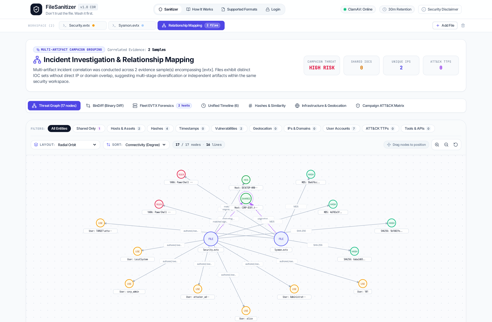</a>
      <br /><strong>Multi-Artifact Investigation Workspace</strong><br />
      <sub>Multi-file tabs with real-time risk indicators, instant tab switching, & Relationship Mapping</sub>
    </td>
    <td width="50%" align="center" valign="top">
      <a href="docs/screenshots/02_threat_graph.png">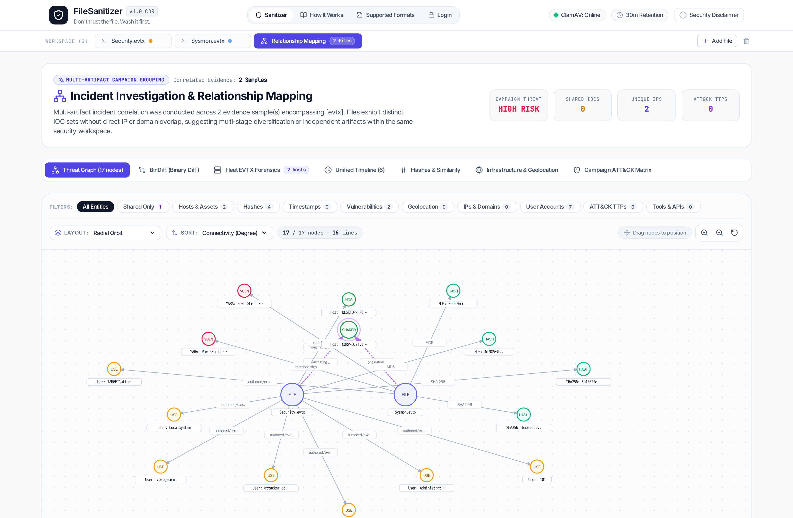</a>
      <br /><strong>Incident Threat Relationship Graph</strong><br />
      <sub>Dot-matrix canvas with Host nodes, lateral movement directed links, & Entity Inspector drawer</sub>
    </td>
  </tr>
  <tr>
    <td width="50%" align="center" valign="top">
      <a href="docs/screenshots/03_unified_timeline.png">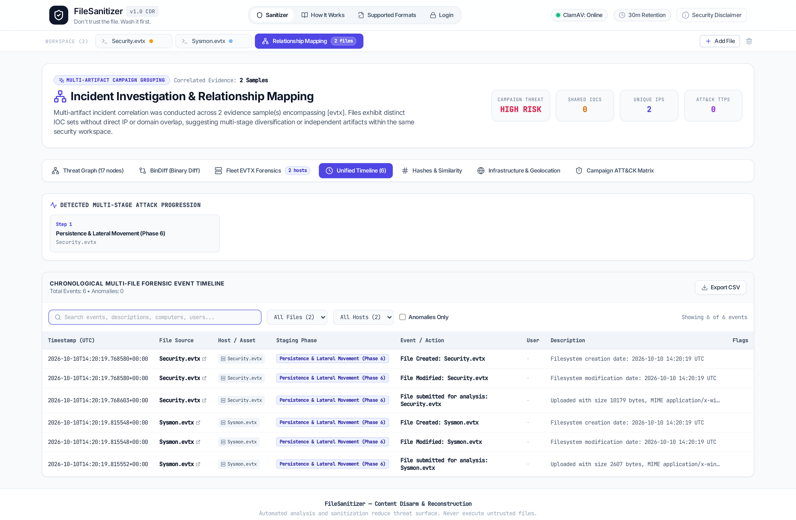</a>
      <br /><strong>Unified Multi-File Chronological Timeline</strong><br />
      <sub>Interleaved events across all files with Cyber Kill Chain phases & Host/User badges</sub>
    </td>
    <td width="50%" align="center" valign="top">
      <a href="docs/screenshots/04_fleet_evtx.png">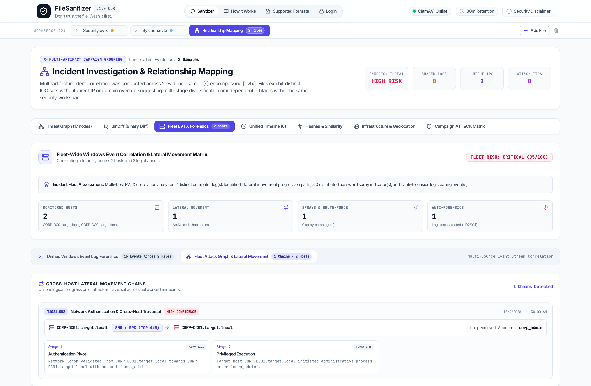</a>
      <br /><strong>Fleet EVTX Forensics & Comparison Matrix</strong><br />
      <sub>Cross-host telemetry matrix, distributed password spray analysis, & lateral movement chains</sub>
    </td>
  </tr>
  <tr>
    <td width="50%" align="center" valign="top">
      <a href="docs/screenshots/05_pcap_beaconing.png">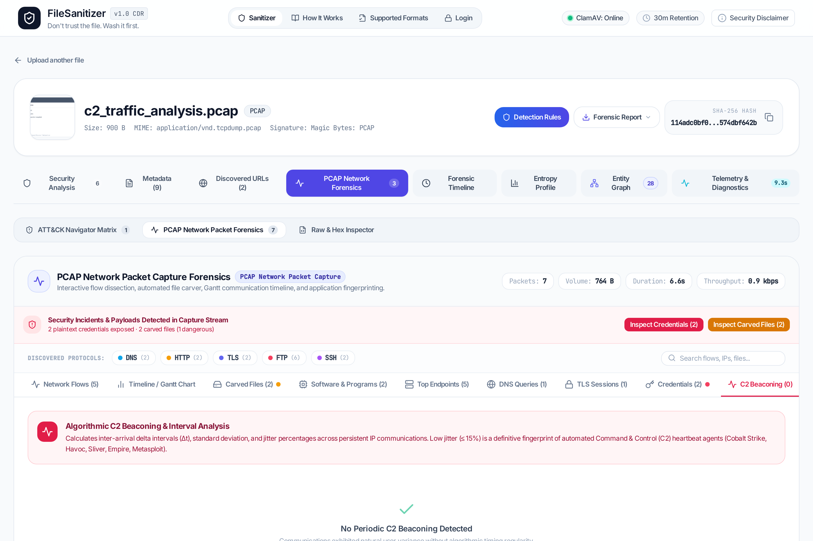</a>
      <br /><strong>Network PCAP Advanced Analytics</strong><br />
      <sub>C2 periodic beaconing detection, jitter % calculation, sleep cycles, & TLS JA3/JA3S fingerprinting</sub>
    </td>
    <td width="50%" align="center" valign="top">
      <a href="docs/screenshots/06_pcap_terminal.png">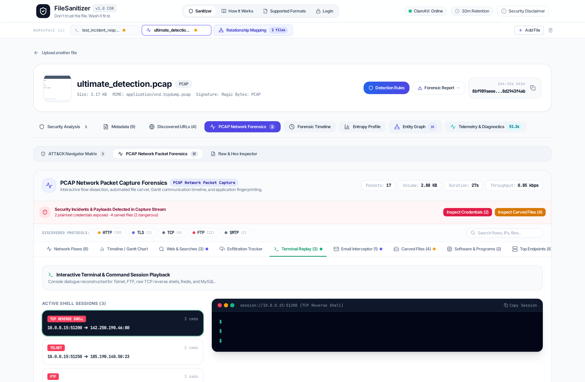</a>
      <br /><strong>Network PCAP Terminal Session Replay</strong><br />
      <sub>Interactive terminal replay (SSH, Telnet, PowerShell), HTTP request/response payloads, & carved artifacts</sub>
    </td>
  </tr>
  <tr>
    <td width="50%" align="center" valign="top">
      <a href="docs/screenshots/07_binary_decompiler.png">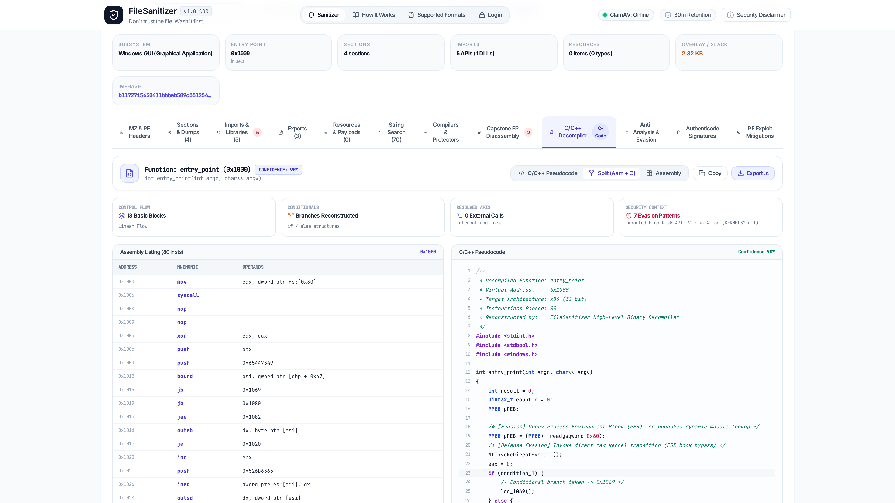</a>
      <br /><strong>High-Level C/C++ Binary Decompiler</strong><br />
      <sub>Machine code reconstruction into structured C pseudocode, Split (Asm + C) view, & .c source export</sub>
    </td>
    <td width="50%" align="center" valign="top">
      <a href="docs/screenshots/08_symbol_renaming.png">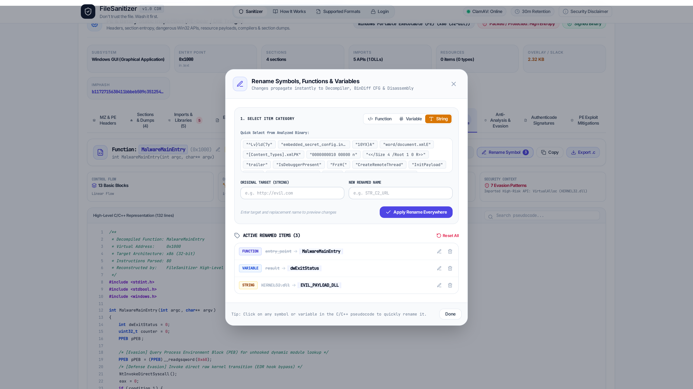</a>
      <br /><strong>Global Symbol & Variable Renaming Engine</strong><br />
      <sub>Light-theme modal with token quick-picks and instant reactive propagation across all workspace views</sub>
    </td>
  </tr>
  <tr>
    <td width="50%" align="center" valign="top">
      <a href="docs/screenshots/09_bindiff_cfg.png">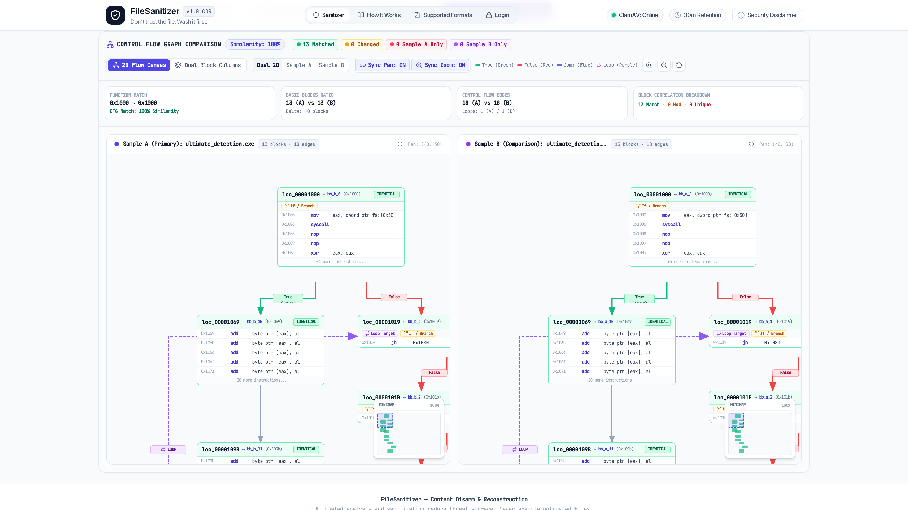</a>
      <br /><strong>Zynamics BinDiff 2D Flow Canvas & CFG</strong><br />
      <sub>Orthogonal edge routing, semantic instruction diffing (MOD/NEW/DEL), interactive minimap, & free dragging</sub>
    </td>
    <td width="50%" align="center" valign="top">
      <a href="docs/screenshots/10_detection_rules.png">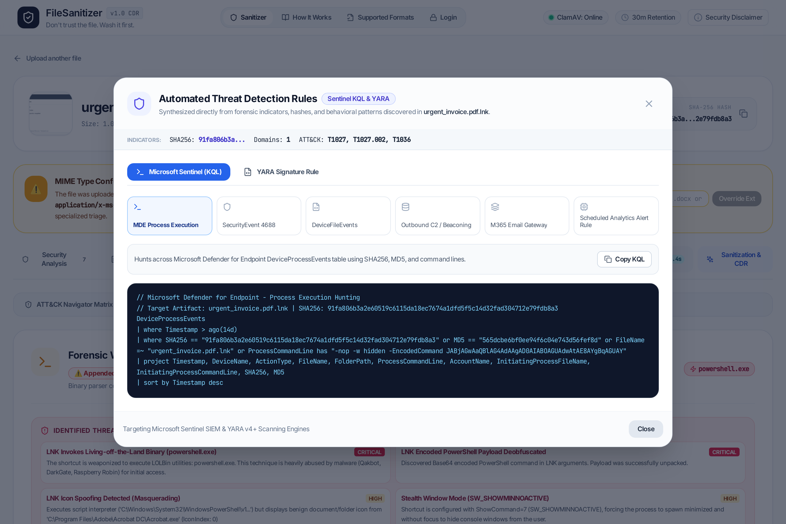</a>
      <br /><strong>Automated Detection Rule Generation</strong><br />
      <sub>Instant Microsoft Sentinel KQL queries and compiled YARA rules tailored to discovered indicators</sub>
    </td>
  </tr>
  <tr>
    <td width="50%" align="center" valign="top">
      <a href="docs/screenshots/11_security_dashboard.png">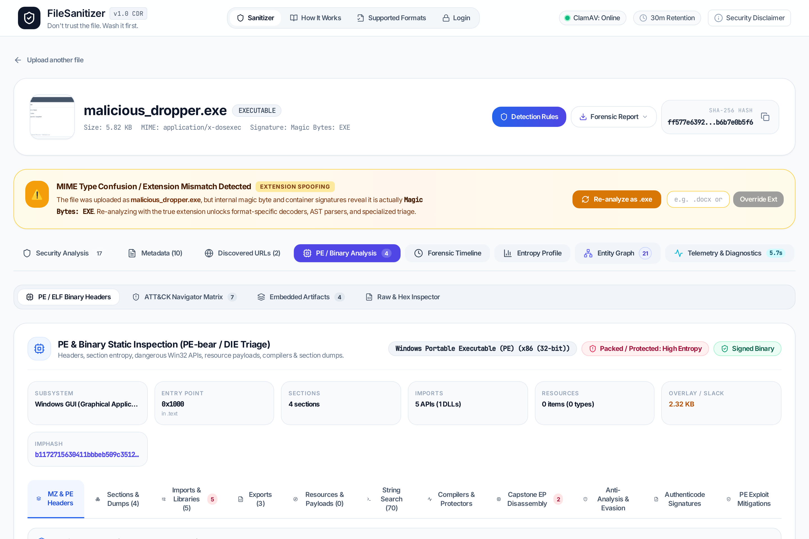</a>
      <br /><strong>Security Analysis & Static Binary Triage</strong><br />
      <sub>PE-bear/DIE architecture, Capstone disassembly, Authenticode signatures, and checksec mitigations</sub>
    </td>
    <td width="50%" align="center" valign="top">
      <a href="docs/screenshots/12_lnk_dissection.png">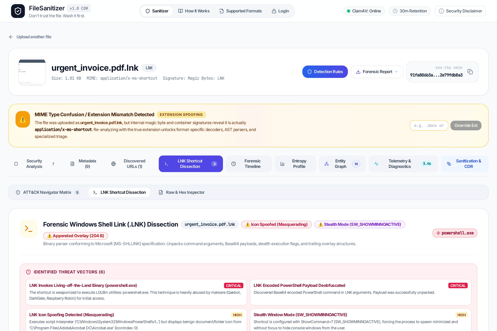</a>
      <br /><strong>Windows LNK Shortcut Dissection</strong><br />
      <sub>[MS-SHLLINK] binary parsing, LOLBin identification, PowerShell deobfuscation, & window mode 7 stealth</sub>
    </td>
  </tr>
  <tr>
    <td width="50%" align="center" valign="top">
      <a href="docs/screenshots/13_office_excel.png">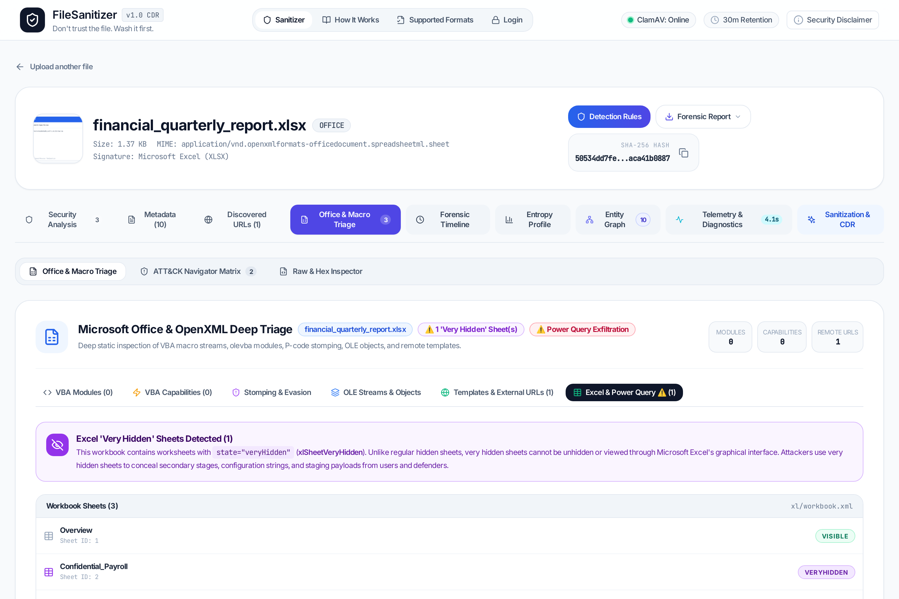</a>
      <br /><strong>Advanced Excel & Office Forensics</strong><br />
      <sub>Very Hidden Sheets (xlSheetVeryHidden), Power Query M-Code exfiltration, & VBA stomping/purging</sub>
    </td>
    <td width="50%" align="center" valign="top">
      <a href="docs/screenshots/14_qr_quishing.png">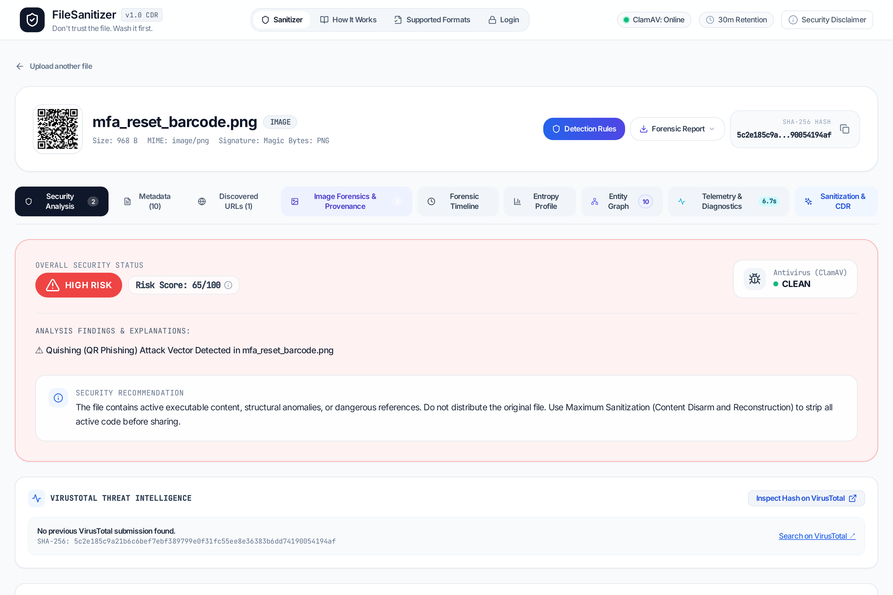</a>
      <br /><strong>QR Code ("Quishing") & Email Forensics</strong><br />
      <sub>Automated QR extraction from images/PDFs/emails, credential lure scoring, & RFC header authentication</sub>
    </td>
  </tr>
  <tr>
    <td width="50%" align="center" valign="top">
      <a href="docs/screenshots/15_mitre_navigator.png">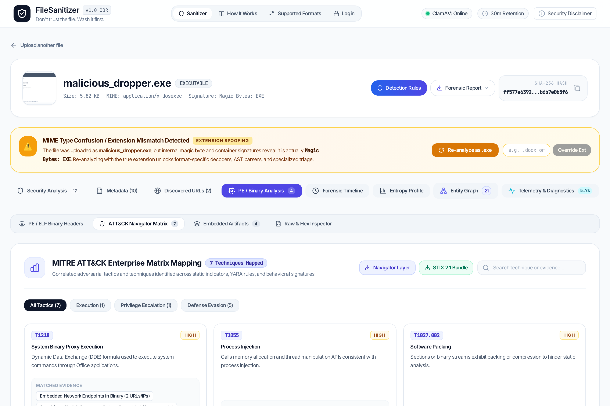</a>
      <br /><strong>Interactive MITRE ATT&CK Navigator</strong><br />
      <sub>Tactical heatmapping across kill chain tactics with granular technique evidence logs & layer export</sub>
    </td>
    <td width="50%" align="center" valign="top">
      <a href="docs/screenshots/16_entity_graph.png">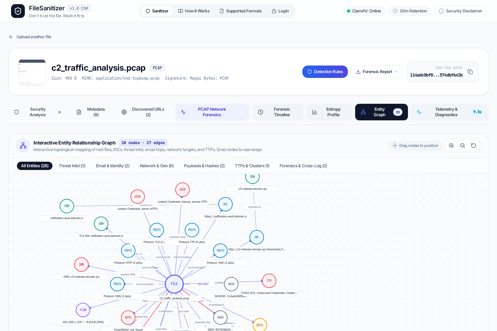</a>
      <br /><strong>Interactive Forensic Entity Graph</strong><br />
      <sub>Force-directed graph connecting files, cryptographic hashes, extracted URLs, users, & network IOCs</sub>
    </td>
  </tr>
</table>

---

## 1. Overview & Architecture

```text
UPLOAD
   ↓
FILE IDENTIFICATION (Magic-byte detection, cryptographic MD5/SHA-1/SHA-256)
   ↓
SECURITY ANALYSIS
   ├── ClamAV Antivirus Scanner (Isolated daemon, multi-database)
   ├── YARA Rules Engine (Custom rules & live compilation)
   ├── MITRE ATT&CK Matrix & Attribution (Automated tactic & technique mapping)
   ├── LNK Shortcut Dissection ([MS-SHLLINK], PowerShell deobfuscation, LOLBins, Mode 7, Icon Spoofing)
   ├── EVTX Windows Event Forensics (Logons, Kerberos, 4688 LOLBins, 7045 Services, SMB Lateral Movement)
   ├── PCAP Advanced Analytics (JA3/JA3S, HASSH, C2 Periodic Beaconing, Jitter %, DNS Tunneling)
   ├── Document & File Structure Analysis (Didier Stevens PDFiD, oledump)
   ├── Office Deep Triage (VBA Stomping/Purging, XLM, Very Hidden Sheets, M-Code, Action Traps)
   ├── PE / ELF Binary Triage (Imphash, Rich Header MD5, Capstone EP Disassembly, Authenticode)
   ├── Script & Command Triage (PowerShell, Bash, PHP webshells, VBS, Batch, AST patterns)
   ├── Image Deep Forensics (LSB Chi-Square Stego, Appended Overlays, JPEG ELA)
   ├── Quishing Analysis (OpenCV QR Code extraction in Images, PDFs & Email attachments)
   ├── Email & Phishing Forensics (Homoglyphs, VIP Impersonation, Thread Hijacking, HTML Smuggling)
   ├── Metadata Extraction (EXIF, GPS, XMP, IPTC, Author, Camera)
   ├── Embedded Object & Payload Extractor (PDF, Office, PE, EML, Polyglots)
   ├── Active Content & Scripts (PDF JS, SVG/HTML scripts, macro hooks)
   ├── URL Extraction & SSRF-Protected Analysis
   ├── Sandboxed Web Preview (Headless browser screenshot)
   ├── Domain/IP Threat Intelligence Platform (Parallel async pipeline, zero-latency SSRF validation)
   │     ├── Nmap Active Service Reconnaissance (sudo nmap -sS -sV --version-light -T3 --open -Pn --reason -oA)
   │     ├── Forward-Confirmed Reverse DNS (FCrDNS bi-directional PTR validation)
   │     ├── Web Archive (Wayback Machine) Calendar Integration & Delta Diffing
   │     ├── Related Infrastructure & Pivots (Smart separation of Direct Affiliates vs CDN/DDoS edge noise)
   │     ├── Email Security & Spoofability Audit (DMARC, DKIM, SPF enforcement)
   │     ├── Subdomain Topology & Attack Surface (crt.sh, SANs, DNS brute-force)
   │     └── Active Security Audit Probes (Sensitive files, WAF detection, CORS/HTTP methods, TLS cryptography)
   └── External Threat Intelligence (VirusTotal, Hybrid Analysis, ThreatFox, CIRCL, AbuseIPDB, IPinfo, MXToolbox, RDAP)
   ↓
EXPLAINABLE RISK EVALUATION & DETECTION RULE GENERATION (Sentinel KQL & YARA)
   ↓
USER SELECTS SANITIZATION OPTIONS (Category-tailored profiles: Minimal / Privacy / Security / Maximum CDR)
   ↓
SANITIZATION & CONTENT DISARM AND RECONSTRUCTION (CDR)
   ↓
POST-SANITIZATION VALIDATION (Full pipeline re-scan & verification)
   ↓
CLEAN FILE READY FOR DOWNLOAD
```

### Key Security Principles

* **The original uploaded file is never overwritten.** All transformations produce a new file in an isolated workspace.
* **Non-Root & Principle of Least Privilege:** Application containers run as unprivileged users (`appuser`, `pwuser`), drop all Linux capabilities (`cap_drop: [ALL]`), and enforce `no-new-privileges:true`.
* **Zero Host Path Traversal:** File paths are never derived from user input. Each upload receives a cryptographically random UUID workspace (`/jobs/<job-id>/`).
* **Strict SSRF Defense:** Any discovered URL is validated through an IP resolution firewall before connection. Private ranges (RFC 1918), loopback, link-local, cloud metadata (`169.254.169.254`), and Docker internal networks are blocked.
* **Explainable Risk Engine:** Security classifications always include specific, actionable reasons and explicit disclaimers rather than opaque numerical scores.
* **Interactive Upload Streaming & Progress Visualization:** Smooth animated upload progression graphic handles multi-gigabyte files (EVTX, PCAP, ISO, disk images) with real-time transfer state and byte counters.

---

## 2. Supported File Formats & Capabilities

| Format Group | Formats | Security Analysis | Sanitization & CDR Capabilities |
| :--- | :--- | :--- | :--- |
| **Documents (PDF)** | PDF, PDF/A | JavaScript, OpenAction, Launch actions, AcroForms, XFA dynamic forms, attachments, embedded streams, incremental updates, URLs, and QR code ("Quishing") detection in rasterized page streams. | **Selective Disarm:** Remove metadata, annotations, JS, attachments, links.<br>**Maximum CDR:** Full-page pixel rasterization (pages → images → clean PDF). |
| **Office Documents** | DOCX, XLSX, PPTX, DOC, XLS, PPT, RTF, ODT, ODS, ODP | VBA Macros, VBA Stomping (P-code vs source discrepancy), VBA Purging, Excel 4.0 (XLM) Macros, Excel "Very Hidden" Sheets (`xlSheetVeryHidden` in `xl/workbook.xml`), Power Query M-Code exfiltration (`Web.Contents()`), PowerPoint mouse-over / action triggers (`ppaction://program`), hidden slides (`show="0"`), RTF exploits (CVE-2017-11882, CVE-2021-40444, `\objautlink`), Remote Template Injection, ActiveX/OLE controls, DDE formulas. | **Structural CDR:** Strip VBA macros (`vbaProject.bin`), purge ActiveX/OLE, neutralize external relationship targets (`attachedTemplate`), unhide sheets, clear tracked changes and metadata. |
| **Windows Shortcuts (LNK)** | LNK | `[MS-SHLLINK]` binary parsing, target command reconstruction, Base64/Unicode PowerShell payload deobfuscation (`-EncodedCommand`), LOLBin detection (`powershell.exe`, `cmd.exe`, `mshta.exe`, `rundll32.exe`, `cscript.exe`), stealth window mode 7 (`SW_SHOWMINNOACTIVE`) & mode 0 (`SW_HIDE`), icon masquerading/spoofing (PDF/DOCX icon disguise), FILETIME creation/modification/access timestamps, and trailing overlay extraction. | **Shortcut Disarm:** Defang target execution command line, neutralize LOLBin invocations, remove trailing overlay payload, export structured triage dossier or compile into non-executable Vector PDF. |
| **Windows Event Logs (EVTX)** | EVTX | Chunk-level binary XML parsing, Curated Security & Forensic Event IDs, logon analysis (4624, 4625), brute force & password spraying, Kerberos ticket abuse (4768, 4769, 4771, Golden/Silver tickets), LOLBin process creation (4688 with parent-child CLI audit), service installations (7045/4697), clearing audit logs (1102/104), Defender tampering, SMB lateral movement (5140/5145). Interactive card migration between Curated and Standard/Extended sets. | **Log Sanitizer:** Anonymize user SIDs, machine hostnames, internal IPs, and export sanitized event streams or structured forensic timeline. |
| **Network Packet Captures** | PCAP, PCAPNG, CAP | Protocol dissection (DNS, HTTP, TLS, SMB, Kerberos, SSH, FTP, QUIC), periodic C2 beaconing detection (inter-arrival delta intervals, jitter %, sleep cycle clustering, heartbeat classification), pure-Python JA3/JA3S TLS fingerprinting with malware hash matching, HASSH SSH fingerprinting, high-entropy DNS tunneling / DGA heuristics, and network IOC extraction. | **PCAP Sanitizer:** Scrub sensitive internal IP ranges, anonymize MAC addresses, strip credentials / cleartext payloads, export sanitized PCAP or CSV summary. |
| **Images** | JPEG, PNG, GIF, TIFF, BMP, WEBP | EXIF tags, GPS physical coordinates, camera serial numbers, author/artist tags, ICC profiles, XMP packets, LSB Chi-Square steganography, appended overlay / polyglot payloads (ZIP/PE/scripts after EOF), chunk integrity, JPEG Error Level Analysis (ELA), QR Code ("Quishing") detection & credential lure scoring, and **AI Image Verification & C2PA Provenance** (IPTC `trainedAlgorithmicMedia`, OpenAI DALL-E, Midjourney, Stable Diffusion prompt extraction, camera hardware verification). | **Privacy & Disarm:** Strip EXIF/GPS/XMP, remove appended overlay payloads, purge synthetic AI markers, re-encode pixel data, flatten alpha transparency onto solid white, format conversion (PNG/JPG). |
| **Active Vector Graphics** | SVG | `<script>` elements, inline DOM event handlers (`onload`, `onclick`), `javascript:` URIs, external resource imports, XML entities (XXE) | **Safe XML Disarm:** Strip script elements and handlers.<br>**Safest CDR:** Rasterize SVG to clean PNG. |
| **Web & Markup** | HTML, HTM | JavaScript blocks, external `<script src>`, `<iframe>`, interactive forms, event handlers, meta refresh redirects, embedded plugins | **HTML Disarm:** Strip scripts, iframes, and forms.<br>Neutralize external hyperlinks. |
| **Browser Extensions** | CRX, ZIP | Chrome & Edge extension packages (Manifest V2 & V3), permission risk scoring (critical/high/medium/low), CSP policy audit (`unsafe-eval`, `unsafe-inline`, remote origins), background service workers, content script injection scopes, and static JavaScript heuristic scanning (`eval`, cookie access, keylogging, beacon exfiltration). | **Extension Disarm:** Strip elevated permissions from manifest, quarantine external telemetry origins, deobfuscate scripts, export structured triage dossier. |
| **macOS AppleScript & Apps** | APPLESCRIPT, SCPT, APP | macOS Open Scripting Architecture (OSA) plain text source and compiled bytecode (`.scpt`), privilege escalation (`with administrator privileges`), credential harvesting dialogs (`hidden answer`), keystroke logging (`System Events`), dropper cradles, and macOS `.app` bundle / Mach-O triage. | **Script Disarm:** Defang root execution hooks, isolate remote dropper URLs, convert into read-only vector PDF review dossier, enforce non-executable permissions (`0o644`). |
| **Archives** | ZIP, JAR, 7Z, TAR, GZIP | Recursive safe inspection without blind extraction: path traversal (`../`), zip bombs (ratio & size limits), executables (`.exe`, `.bat`, `.ps1`), Java Archive manifest inspection (`Main-Class`, `all-permissions`), dangerous bytecode execution APIs (`ProcessBuilder`, `Runtime.exec`, `URLClassLoader`, `sun.misc.Unsafe`), password protection | **Safe Member Repack:** Exclude traversal entries, strip executable binaries, package clean archive. |
| **Emails & Messages** | EML, MSG, MBOX | Full RFC header audit, SPF/DKIM/DMARC/ARC validation, homoglyph & Punycode domain spoofing (`xn--`), VIP impersonation, thread hijacking (`Re:` without headers), HTML smuggling (Blob/data URIs), inline QR Code Quishing analysis, MTA hop latency & geolocation, tracking pixels, attachment relationship graph | **Email Disarm:** Neutralize external tracking pixels, defang phishing URLs, strip dangerous attachments, reconstruct clean RFC message or export hardened vector PDF review document. |
| **Executables & Binaries** | EXE, DLL, SYS, SCR, ELF, Mach-O | PE-bear & DIE static triage, DOS/PE/Optional headers, Imphash & Rich Header Hash (RichPV / Cleartext MD5), Capstone EP Disassembly (PEB access, direct syscalls, shellcode prologues), **High-Level C/C++ Binary Decompiler** (reconstructs C pseudocode, signatures, variables, branches/loops, API calls, and evasion constructs with Split Asm+C view and `.c` source export), Anti-Analysis heuristics (anti-debugging, timing evasion), Authenticode PKCS#7 verification, Linux ELF mitigations (NX, PIE, RELRO, Canary, Stripped), string search with min/max length filtering | **Binary Disarm:** Strip digital certificate overlays, purge abnormal embedded PE resources, isolate dangerous strings, enforce non-executable file permissions (`0o644`). |
| **Scripts & Command Files** | PS1, VBS, VBA, SH, JS, PHP, CMD, BAT | Static AST & regex analysis: dynamic code execution (`IEX`, `eval`), download cradles (`DownloadString`, `curl | sh`), memory injection / AMSI bypass, Base64 block decoding with preview, LOLBin usage (`certutil`, `bitsadmin`, `mshta`), PHP webshell signatures, Shannon entropy | **Script Sanitizer:** Defang all URLs, disarm dynamic execution hooks (`IEX`, `eval`, `system`), append security disclosure banners, enforce non-executable permissions (`0o644`), or compile into read-only vector PDF review document. |
| **Domain/IP & Infrastructure** | URL, Domain, IPv4, IPv6 | Non-blocking async threat platform: Live sandboxed Chromium webpage screenshot, full DNS resolution & Forward-Confirmed Reverse DNS (FCrDNS), BGP routing & ASN profiling, Nmap Active Service Reconnaissance (`sudo nmap -sS -sV --version-light -T3 --open -Pn --reason -oA`), Active Security Probes (sensitive file exposure, WAF detection, CORS/HTTP methods), Web Archive (Wayback Machine) calendar integration & snapshot diffing, Smart Infrastructure Pivots (separating direct affiliates from CDN/DDoS edge noise), Typosquatting Radar, and Email Security (DMARC/DKIM/SPF). | **Network Defang & Report:** Defang active URLs and domain IOCs (`hxxp://`, `[.]`), export structured threat intelligence dossiers (JSON/PDF). |
| **Plain Text & Data** | TXT, CSV, JSON, XML, YAML, Markdown | Character encoding analysis (UTF-8, UTF-16, BOM), CSV formula injection (DDE execution attacks) | **Text Sanitizer:** Strip BOM, sanitize DDE formula prefixes (`=`, `+`, `-`, `@`), strip control characters. |

---

## 3. Installation & Docker Deployment

### Prerequisites

* [Docker](https://docs.docker.com/get-docker/) (v24.0 or newer)
* [Docker Compose](https://docs.docker.com/compose/) (v2.20 or newer)

### Docker Compose Architecture

The application runs as an isolated multi-container architecture defined in `docker-compose.yml`:

| Service Container | Port / Binding | Role & Technology |
| :--- | :--- | :--- |
| `filesanitizer-frontend` | `80:80`, `8080:80` | Nginx reverse proxy serving the React 19 + TypeScript + Vite single-page application. |
| `filesanitizer-api` | `8000:8000` | FastAPI Python 3.11 asynchronous API engine, forensic analyzers, Nmap 7.95+ active service scanner, and CDR pipelines (`cap_add: [SETUID, SETGID, NET_RAW, NET_ADMIN, AUDIT_WRITE]`). |
| `filesanitizer-worker` | Internal network | Celery distributed worker executing asynchronous threat analysis, Nmap active reconnaissance, and heavy processing (`cap_add: [SETUID, SETGID, NET_RAW, NET_ADMIN, AUDIT_WRITE]`). |
| `filesanitizer-redis` | `6379` (Internal) | Redis in-memory message broker, task queue, and intermediate cache. |
| `filesanitizer-clamav` | `3310` (Internal) | ClamAV antivirus scanner daemon with automatic `freshclam` signature database updates. |
| `filesanitizer-browser` | `3000` (Internal) | Isolated Playwright Node.js headless browser for sandboxed URL previews and screenshots. |

### Quick Start Deployment

1. Clone the repository:
   ```bash
   git clone https://github.com/jozeta/FileSanitizer.git
   cd FileSanitizer
   ```

2. Configure environment variables:
   ```bash
   cp .env.example .env
   ```

3. Launch all services with Docker Compose:
   ```bash
   docker compose up -d --build
   ```

4. Verify health and service status:
   ```bash
   # Check running containers
   docker compose ps

   # Verify API health check
   curl http://localhost:8000/api/health
   ```

5. Access the application:
   * **Web Interface:** [http://localhost](http://localhost) (or [http://localhost:8080](http://localhost:8080))
   * **Interactive API Documentation (Swagger / OpenAPI):** [http://localhost:8000/docs](http://localhost:8000/docs)
   * **Alternative API Documentation (ReDoc):** [http://localhost:8000/redoc](http://localhost:8000/redoc)

### Running Automated Test Suite

```bash
# Execute backend unit and integration test suite
docker compose exec api pytest tests/ -v

# Verify frontend build & TypeScript compilation
docker compose exec frontend sh -c "cd /usr/share/nginx/html && ls -la"
# Or locally:
cd frontend && npm run build
```

---

## 4. Configuration Reference

All settings can be configured via environment variables or the `.env` file:

```env
# Application Settings
APP_NAME=FileSanitizer
APP_ENV=production
DEBUG=false
API_PREFIX=/api

# Storage & Privacy Retention
JOBS_DIR=/jobs
MAX_FILE_SIZE_MB=100
FILE_RETENTION_MINUTES=30
CLEANUP_INTERVAL_SECONDS=300

# Archive Processing Safety Quotas
MAX_ARCHIVE_FILES=10000
MAX_ARCHIVE_SIZE_MB=500
MAX_RECURSION_DEPTH=5
MAX_PROCESSING_TIME=300

# ClamAV Antivirus Daemon
CLAMAV_ENABLED=true
CLAMAV_HOST=clamav
CLAMAV_PORT=3310
CLAMAV_TIMEOUT=30

# Optional URL Reputation Providers
VIRUSTOTAL_ENABLED=false
VIRUSTOTAL_API_KEY=your_virustotal_api_key

SAFE_BROWSING_ENABLED=false
SAFE_BROWSING_API_KEY=your_google_safe_browsing_key

URLHAUS_ENABLED=false
URLHAUS_API_KEY=your_urlhaus_api_key

# Sandboxed Playwright Screenshot Service
SCREENSHOT_ENABLED=true
BROWSER_SERVICE_URL=http://browser:3000/screenshot
SCREENSHOT_TIMEOUT=15

# Redis Broker
REDIS_URL=redis://redis:6379/0
```

---

## 5. Antivirus & Security Engines Setup

### ClamAV Integration

FileSanitizer connects to ClamAV over a local TCP stream socket (`INSTREAM` protocol).

* In Docker Compose, the `clamav` container initializes automatically and updates its signature database in the background via `freshclam`.
* The API dynamically displays engine version and database signature date.
* **Malware Quarantine Policy:** If ClamAV flags a file as `MALICIOUS`, FileSanitizer prevents downloading the original file and displays a critical warning.

### Threat Intelligence & External Sandbox Feeds

To enable external threat intelligence feeds for discovered hashes, files, and URLs:

1. **VirusTotal:** Set `VIRUSTOTAL_ENABLED=true` and provide `VIRUSTOTAL_API_KEY`.
2. **Hybrid Analysis (Falcon Sandbox):** Set `HYBRID_ANALYSIS_ENABLED=true` and provide `HYBRID_ANALYSIS_API_KEY`.
3. **Abuse.ch ThreatFox:** Set `THREATFOX_ENABLED=true` and provide `THREATFOX_API_KEY` for real-time IOC & malware family attribution.
4. **CIRCL Hashlookup & NIST NSRL:** Built-in public REST client; verifies whether binary hashes match known safe OS/application binaries.
5. **AbuseIPDB:** Set `ABUSEIPDB_ENABLED=true` and provide `ABUSEIPDB_API_KEY` to query IP reputation on mail hops and URL domains.
6. **MXToolbox API:** Set `MXTOOLBOX_ENABLED=true` and provide `MXTOOLBOX_API_KEY` for automated mail server health, DKIM, and blacklist verification.
7. **IPinfo.io:** Set `IPINFO_ENABLED=true` and provide `IPINFO_TOKEN` for deep ASN and geolocation lookup.
8. **URLhaus (Abuse.ch):** Set `URLHAUS_ENABLED=true` and provide `URLHAUS_API_KEY`.
9. **Google Safe Browsing:** Set `SAFE_BROWSING_ENABLED=true` and provide `SAFE_BROWSING_API_KEY`.
10. **RDAP / WHOIS:** Automatically queries authoritative RIRs (ARIN, RIPE, APNIC, LACNIC, AFRINIC) with zero configuration or API keys required.

*(Note: API keys are securely held on the backend and never exposed to the frontend browser).*

---

## 6. REST API Reference

| Method | Endpoint | Description |
| :--- | :--- | :--- |
| `POST` | `/api/files` | Upload one or multiple files. Queues asynchronous analysis. |
| `GET` | `/api/files` | List active jobs in workspace. |
| `GET` | `/api/jobs/{id}` | Get job state, progress percentage, and summary. |
| `GET` | `/api/jobs/{id}/analysis` | Get complete findings, risk evaluation, hashes, and AV scan. |
| `GET` | `/api/jobs/{id}/metadata` | Get structured metadata grouped by category with sensitivity tags. |
| `GET` | `/api/jobs/{id}/urls` | Get extracted URLs, domain reputation, and screenshot metadata. |
| `GET` | `/api/jobs/{id}/screenshots/{file}` | Retrieve sandboxed website screenshot preview. |
| `POST` | `/api/jobs/{id}/sanitize` | Trigger sanitization and CDR with chosen profile or custom options. |
| `GET` | `/api/jobs/{id}/result` | Get post-sanitization validation and before/after comparison. |
| `GET` | `/api/jobs/{id}/download` | Download the sanitized clean file. |
| `GET` | `/api/jobs/{id}/report` | Download structured security audit report in JSON. |
| `DELETE` | `/api/jobs/{id}` | Immediately purge workspace and temporary artifacts. |
| `GET` | `/api/jobs/{id}/detection-rules` | Generate automated Microsoft Sentinel (KQL) and YARA detection rules tailored to discovered IOCs, commands, and hashes. |
| `POST` | `/api/jobs/correlate` | Correlate multiple forensic jobs into an incident campaign workspace (BinDiff binary similarity, force-directed threat graph, unified timeline & timestomping, hash matrix, IP geolocation, and ATT&CK kill chain). |
| `POST` | `/api/files/investigate-ioc` | Submit a remote URL, Domain, or IP address for comprehensive threat intelligence analysis. |
| `POST` | `/api/jobs/{id}/active-recon` | Trigger operator-authorized Nmap service reconnaissance and active security audit probes on a domain or IP. |
| `POST` | `/api/fetch-url` | Submit a public or intranet-safe URL for SSRF-protected sandboxed analysis and website screenshot capture. |
| `GET` | `/api/health` | Service health check and scanner connectivity diagnostics. |

---

## 7. Data Retention & Privacy

FileSanitizer operates on zero persistent storage for user content:

* **Automatic Workspace Purge:** An internal daemon runs every `CLEANUP_INTERVAL_SECONDS` and deletes all files belonging to jobs older than `FILE_RETENTION_MINUTES` (default: 30 minutes).
* **Manual Immediate Purge:** Users can clear workspace data immediately by deleting the job or resetting the session.
* **No Content Logging:** File contents and sensitive metadata fields are never written to application logs.

---

---

## 8. Administrator Settings & Threat Engine Management

FileSanitizer includes a dedicated **Administrator Console** accessible via the top navigation bar (`⚙️ Settings`). Access requires authentication.

### Authentication & Configuration

Credentials and secrets are configured via environment variables in `.env`:
* `ADMIN_USERNAME`: Default `admin`
* `ADMIN_PASSWORD`: Default `admin`
* `ADMIN_SECRET_KEY`: 32-character secret key used to sign session JWTs.

### Configurable Security Policies & API Keys

1. **Security Checks Policy:** Toggles for global scan engines (ClamAV, YARA, VirusTotal, URL Reputation, Playwright Sandbox) and fine-grained per-format inspection checks (PDF JavaScript, Didier Stevens PDFiD, /Launch actions, Office VBA macros, olevba code inspection, ActiveX, OLE embeddings, Image EXIF/GPS, Archive zip bombs, etc.).
2. **API Keys:**
   * **VirusTotal API Key (v3):** When configured, FileSanitizer performs automated file hash queries and URL threat ratings.
   * **Direct VirusTotal Fallback:** When left unconfigured, FileSanitizer provides direct, clickable search links (`https://www.virustotal.com/gui/file/{sha256}` and `https://www.virustotal.com/gui/search/{url}`) for every file hash and extracted link.
   * **Google Safe Browsing & URLhaus:** Pluggable API keys for real-time URL reputation screening.

### ClamAV Engine & Definition Management

* Displays the active daemon status (`ONLINE`/`OFFLINE`), engine version (e.g. `ClamAV 1.5.4`), and signature database version & date.
* Lists all installed database files (`main.cvd`, `daily.cld`, `bytecode.cvd`) with file sizes and modification timestamps.
* **Update Definitions from Official Mirror:** Triggers an automated fetch of official ClamAV signature updates and issues a live `RELOAD` command to `clamd`.
* **Manual Definition Upload:** Supports uploading `.cvd`, `.cld`, `.ndb`, `.hdb`, or `.yar` files directly through the web interface for air-gapped or customized environments.

### YARA Detection Rules Engine

* Pre-seeded with built-in rules for suspicious VBA macro keywords, PDF `/Launch` and heap spray exploitation, embedded Windows PE (`MZ`/`PE`) executables, active script injection in SVG markup, and command-line dropper artifacts.
* **Add Custom YARA Rules:** Upload one rule at a time with a custom Name, Target Format filter (`ALL`, `PDF`, `OFFICE`, `IMAGE`, `ARCHIVE`, `SVG_HTML`, `TEXT`), Severity rating (`CRITICAL`, `HIGH`, `MEDIUM`, `LOW`, `INFO`), and rule text.
* All uploaded rules are compiled and validated with `yara-python` before installation.

### Advanced Analysis & Sandboxed Code Viewer

* **Didier Stevens PDFiD & AnalyzePDF Tools:** Stream and token inspection detecting obfuscated hex characters (e.g. `/#4a#61vaScript`, `/#4c#61unch`) used to evade simple string scanners, along with automatic extraction of JavaScript code blocks.
* **olevba Macro Inspection:** Deobfuscates and extracts Visual Basic for Applications (VBA) code across document modules (`ThisDocument`, `Module1`, etc.).
* **Syntax-Highlighted Code Viewer Modal:** When JavaScript or VBA macros are detected in an uploaded file, clicking **"Inspect Code"** opens a sandboxed, read-only viewer featuring syntax highlighting, line numbers, module switching, search filter, copy-to-clipboard, and download options.

---

## 9. Advanced Threat Intelligence, Binary Triage & Embedded Payloads

### Pluggable Threat Intelligence Integrations
FileSanitizer supports live reputation lookups across community and enterprise APIs with full rate-limiting and administrative key management:
* **Hybrid Analysis (Falcon Sandbox):** Automated SHA-256 hash lookups, VxStream threat scores (0–100), malware family classification, MITRE ATT&CK tagging, and multi-AV detection rates.
* **Abuse.ch ThreatFox:** Real-time threat intelligence lookup for Indicators of Compromise (IOCs), identifying associated malware families, confidence levels, and threat categories.
* **CIRCL Hashlookup & NIST NSRL:** National Software Reference Library (NSRL) RDS database matching to instantly verify known good operating system and vendor software binaries.
* **AbuseIPDB v2:** Live abuse confidence scoring, total report tallies, and ISP verification for mail transfer hops and resolved domain hosts.
* **MXToolbox API:** Deep mail server diagnostics, SPF authorization verification, DKIM selector health, and DNS blacklisting (100+ RBLs) for email domains.
* **Didier Stevens oledump:** OLE stream hierarchy analysis, macro indicator flags (`M`/`m`), Excel 4.0 (XLM) macro sheet identification, and DDE command link extraction.
* **RDAP / WHOIS (IANA / ARIN / RIPE):** Authoritative REST-based domain registration queries (RFC 7482 / RFC 9083) to determine domain age, identifying newly registered domains (< 30 days old) without requiring any API keys.
* **IPinfo.io:** IP enrichment with Autonomous System (ASN), carrier details, geolocation, and anonymizer detection (VPN, Tor, Proxy, Hosting botnets).

### Universal Embedded Files & Payload Extraction Engine
Any document, binary, email, or archive can contain nested payloads. FileSanitizer's universal extractor safely pulls embedded payloads into isolated workspace storage without executing code:
* **PDFs:** Extracts catalog `/EmbeddedFiles` attachments and stream objects.
* **Office Documents:** Unwraps OpenXML `embeddings/`, `oleObject*.bin`, and legacy OLE `Ole10Native` packages.
* **PE Binaries:** Detects nested MZ executables, installers, and archives packed inside the `.rsrc` resource section.
* **Emails:** Isolates all message attachments with SHA-256 calculation, safe previews, and threat classification.
* **Actions per Embedded File:** Direct sandboxed download or **"Analyze as New Job"** to launch a full recursive inspection pipeline on the embedded payload.

### MITRE ATT&CK Matrix & Attribution Navigator
FileSanitizer automatically correlates static findings, YARA rule hits, behavioral indicators, and macro/script actions to the MITRE ATT&CK Enterprise Matrix:
* **Automated Mapping:** Translates detected techniques across Execution (TA0002), Persistence (TA0003), Privilege Escalation (TA0004), Defense Evasion (TA0005), Discovery (TA0007), Lateral Movement (TA0008), Collection (TA0009), Command and Control (TA0011), and Initial Access (TA0001).
* **Interactive Frontend Navigator:** Dedicated ATT&CK tab with tactic navigation tabs, real-time technique search, severity filtering (Critical, High, Medium, Low), consolidated evidence logs, and direct links to official MITRE ATT&CK specification pages.

### Script & Command-Line Triage Engine
Deep static AST and regex inspection for scripts and command files (`.ps1`, `.vbs`, `.vba`, `.sh`, `.js`, `.php`, `.cmd`, `.bat`):
* **Suspicious Pattern Matching:** Detects download cradles (`DownloadString`, `curl | sh`), dynamic execution (`Invoke-Expression`, `eval`, `system`, `exec`), AMSI bypasses, process injection, and hidden execution flags.
* **Base64 Payload Extraction:** Scans and extracts embedded Base64 strings, decoding previews automatically for security analyst review.
* **LOLBin Identification:** Flags Living-off-the-Land Binaries (`certutil`, `bitsadmin`, `mshta`, `rundll32`, `wscript`, `cscript`, `curl`, `nc`).
* **Entropy & Webshell Detection:** Measures Shannon entropy and flags high-risk PHP webshell backdoors (`c99`, `r57`, `b374k`, `wso`).
* **Syntax-Highlighted Script Viewer:** Dedicated triage tab displaying line-level detections, matched patterns, and extracted code modules.

### In-Depth Office Forensics
* **VBA Stomping & Purging Detection:** Cross-checks compiled P-code streams against compressed source in `_VBA_PROJECT_CUR` to detect evasion where source code is stripped or overwritten while compiled bytecode executes.
* **Excel 4.0 (XLM) Macro Sheet Extraction:** Scans BIFF8 records for hidden XLM macro and dialog sheets used in dropper documents.
* **Excel "Very Hidden" Sheets:** Parses `xl/workbook.xml` for `<sheet state="veryHidden">` (`xlSheetVeryHidden`). Unlike standard hidden worksheets, "very hidden" sheets cannot be unhidden through the Excel GUI right-click menu, making them a primary stealth vector for hiding staged payloads, shellcode byte arrays, and exfiltration tables.
* **Power Query M-Code Exfiltration:** Inspects `xl/connections.xml`, `xl/queryTables/`, and DataMashup packages for external HTTP requests triggered via Power Query M-code (`Web.Contents()`, `OData.Feed()`), which execute outbound callbacks without prompting for macro enablement.
* **PowerPoint Mouse-Over / Action Traps:** Scans slide definitions for mouse-over triggers (`<a:hlinkHover action="ppaction://program">`) and click action triggers configured to execute arbitrary system binaries without clicking, alongside hidden slides (`show="0"`).
* **RTF Exploit Scanning:** Detects Equation Editor exploits (`CVE-2017-11882`), MSHTML container exploits (`CVE-2021-40444`), and automatic OLE link hijacking (`\objautlink`).
* **Remote Template Injection:** Identifies external `attachedTemplate` target URLs designed to deliver secondary malicious templates upon document open.
* **VBA Capability Tagging:** Automatically categorizes macro capabilities into execution, file drop, evasion, persistence, and network callbacks.

### In-Depth PE / ELF Binary Forensics
* **Import Hash (imphash) & Rich Header MD5 (RichPV / Cleartext):** Computes deterministic hashes for binary clustering, malware campaign tracking, and compiler toolchain identification. Extracts the Microsoft PE Rich Header, decrypts the XOR masking key, and calculates the cleartext MD5 hash (identifying MSVC compiler version, build number, and object modules) alongside imphash.
* **Capstone Engine Disassembly at Entry Point:** Disassembles the first 256 bytes at the entry point to flag Process Environment Block (`PEB`) access (`fs:[0x30]`, `gs:[0x60]`), direct syscall instructions (`syscall`, `sysenter`), and shellcode egg hunter / prologue patterns.
* **High-Level C/C++ Binary Decompiler (Pseudocode Reconstruction):**
  * **Machine Code to C Pseudocode Synthesis:** Built-in Capstone-based decompiler engine that parses entry point instruction streams and synthesizes clean, human-readable, idiomatic C/C++ source code.
  * **Function Signature & Type Recovery:** Recovers function prototypes, parameter types (`int argc, char** argv`), calling conventions, and return value types (`int`, `void`, `HANDLE`, `BOOL`).
  * **Variable & Storage Recovery:** Tracks register usage and stack frame allocations (`rbp - var_4`, `ebp - 0x20`), reconstructing localized variables (`int result`, `uint32_t counter`, `PPEB ppeb`) with storage class classifications (Stack, Register, Pointer).
  * **Control Flow Structuration (AST Generation):** Analyzes basic block branch edges and structurizes conditional jumps (`je`, `jne`, `jb`, `jae`) into clean `if (...) { ... } else { ... }` blocks, while identifying cyclic back-edges to reconstruct `while (...)` and `for (...)` loops.
  * **API Symbol & External Call Resolution:** Correlates CALL instructions with the binary's import and export tables, automatically resolving Win32 (`VirtualAlloc`, `CreateRemoteThread`, `LoadLibraryA`, `GetProcAddress`) and POSIX routines.
  * **Security & Evasion Context Annotations:** Flags low-level evasion patterns directly in the decompiled source code with inline comments:
    * `/* [Evasion] Query Process Environment Block (PEB) for unhooked dynamic module lookup */`
    * `/* [Defense Evasion] Invoke direct raw kernel transition (EDR hook bypass) */`
    * `/* [Anti-Debugging] Process debug port check / timing verification */`
  * **Interactive Tri-Mode Inspection:** Switch between **C/C++ Pseudocode**, **Split (Asm + C)** synchronized side-by-side view, and pure **Assembly Listing**.
  * **Analyst Export Actions:** Single-click clipboard copying (`Copy`) and clean `.c` source file download (`Export .c`).
  * **Global Symbol Renaming & Refactoring Engine (Zero Re-Analysis Propagation):**
    * **Interactive Rename Modal:** Pure light-themed modal for renaming functions, local variables, and string literals without reloading or re-analyzing the binary.
    * **Discovered Symbol Quick-Picks:** Automatically parses identifiers from the decompiled code, presenting one-click chips sorted by occurrence count (`entry_point`, `result`, `counter`, `ppeb`, `loc_*`).
    * **Exact Token Boundary Replacement:** Replaces function names and variable symbols using word boundary matching (`\b<name>\b`), ensuring sub-identifiers or comments are not corrupted.
    * **String Substring Replacement:** Case-sensitive string replacements applied in descending order of string length to prevent collision with compound phrases.
    * **Cross-Component Reactive Propagation:** Renames propagate instantly across all active views in the workspace:
      * **Binary Decompiler:** Dynamically updates function prototypes, AST signatures, variable declarations, and header badges (`Renamed from entry_point`).
      * **BinDiff 2D CFG & Minimap:** Updates basic block header labels and instruction operands in both dual and single canvas views.
      * **BinDiff Linear Disassembly Diff:** Rewrites instruction operands across side-by-side assembly streams.
      * **Capstone Entry Point Disassembly:** Updates assembly operand registers and addresses in the static triage card.
      * **Static String Search:** Strikethroughs the original string and adds an inline `➔ <Renamed>` pill, with 1-click hover rename action.
    * **Workspace Persistence:** Saves renames in `localStorage` under `filesanitizer_symbol_renames_v1`, keeping annotations intact during tab switching and session reloads.
  * **Strict Light Theme Design:** Styled with white cards, slate borders, emerald/indigo code syntax accents, and high-contrast typography.
* **Anti-Analysis & Evasion Heuristics:** Detects anti-debugging APIs (`IsDebuggerPresent`, `CheckRemoteDebuggerPresent`), timing evasion (`RDTSC`, high sleep counts), and hypervisor detection.
* **Authenticode Digital Signatures:** Parses embedded PKCS#7 certificates, issuer DNs, serial numbers, and validity timestamps.
* **Linux ELF Security Mitigations:** Automatically audits binary hardening flags: NX (Non-Executable Stack), PIE (Position Independent Executable), RELRO (Relocation Read-Only), Stack Canary protection, and stripped symbols.
* **String Search & Length Filtering:** Instant filtering of ASCII and Unicode strings with configurable min/max string length (default min length 5) and categorized LOLBin/network views.

### In-Depth Image Forensics & Steganography
* **LSB Steganography Detection:** Chi-Square distribution analysis and Shannon entropy across RGB pixel bitplanes to flag hidden embedded payloads.
* **Appended Overlay & Polyglot Detection:** Scans for abnormal trailing bytes past EOF markers (`FF D9` for JPEG, `IEND` for PNG) harboring hidden ZIP, PE, or script polyglots.
* **Chunk Structure & Parser Exploit Audit:** Audits PNG chunks, dimensions, and compression streams for structural anomalies and decompression bombs.
* **JPEG Error Level Analysis (ELA):** Analyzes compression error levels across image grids to expose digital tampering, splicing, and manipulated regions.
* **QR Code Detection & Quishing Analysis:** Multi-engine OpenCV and pyzbar decoding of 2D Quick Response codes embedded in images. Analyzes extracted URLs against credential harvesting patterns, shorteners, and redirects.

### In-Depth Email & Phishing Forensics
* **Homoglyph & Punycode Domain Spoofing:** Unmasks Cyrillic lookalikes and IDN punycode domains (`xn--`) masquerading as reputable organizations, rendering exact side-by-side visual comparisons of confusable characters.
* **VIP Impersonation & Display Name Spoofing:** Flags discrepancies where high-profile executive display names originate from unauthorized freemail or lookalike domains.
* **Email Thread Hijacking:** Identifies unsolicited messages using `Re:` / `Fwd:` prefixes without matching RFC `In-Reply-To` or `References` thread headers.
* **HTML Smuggling & Obfuscated Payloads:** Flags client-side JavaScript Blob generation, data URI payloads, and obfuscated octet streams designed to bypass secure email gateways.
* **QR Code Quishing in Attachments & Body:** Scans inline images and PDF attachments for credential harvesting QR codes designed to evade Secure Email Gateway (SEG) URL filters.
* **MTA Hop Geolocation & Attachment Graph:** Maps mail transfer agent latency, geographical IP hops, and relationship diagrams for multi-attachment emails.

### Domain/IP Threat Intelligence Platform & Attack Surface Reconnaissance
FileSanitizer provides a high-performance, asynchronous threat intelligence platform for investigating domains, hostnames, IPv4, and IPv6 infrastructure:
* **High-Speed Parallel Pipeline:** Executes investigative modules concurrently across independent worker threads with zero-latency anti-SSRF pre-flight checks, delivering complete threat profiles in seconds.
* **Live Sandboxed Webpage Screenshot:** Headless Chromium captures full-page visual screenshots of submitted domains and web servers, rendered directly as the file thumbnail.
* **Punycode & Homograph Impersonation Visualizer:** Detects Internationalized Domain Names (IDN) and renders the visual Unicode representation alongside the Punycode string, explicitly enumerating confusable characters (e.g., Cyrillic `а` vs Latin `a`).
* **DNS Records Resolution:** Resolves and validates full DNS records: `A`, `AAAA`, `MX` (with preference scores), `NS`, `TXT` (SPF, DKIM, DMARC), `SOA`, and reverse PTR pointers.
* **RDAP / WHOIS Profiling:** Pulls registration date, expiration date, calculated domain age, registrar identity, and DNSSEC validation status.
* **Reverse IP & ASN Intelligence:** Queries Autonomous System Numbers (ASN), organization names, BGP routing prefixes, and discovers co-hosted domains on the target IP.
* **IP & URL Obfuscation Detection:** Decodes Dword (`http://2130706433/`), Hex (`http://0x7f000001/`), Octal (`http://0177.0.0.1/`), double URL percent-encoding, and userinfo `@` credential masking.

### Nmap Active Service Reconnaissance & Daemon Versioning (Strictly Opt-In)
When authorized by the operator, FileSanitizer executes controlled, in-depth service and port reconnaissance using **Nmap 7.95+** with the following production specification:
```bash
sudo nmap -sS -sV --version-light -T3 --open -Pn \
  -p 21,22,23,25,53,80,110,111,135,139,143,443,445,993,995,1433,1521,2049,2375,3306,3389,5432,5900,5985,5986,6379,8080,8443,9200,11211,27017 \
  --reason -oA nmap-service-scan <target>
```
* **Half-Open SYN Stealth Scan (`-sS`):** Sends raw TCP SYN packets without completing the three-way handshake, maximizing scan velocity, stealth, and compatibility across restrictive stateful firewalls.
* **Light Service Versioning (`-sV --version-light`):** Employs probe intensity 2 (out of 9), interrogating open ports with targeted service banners while keeping total scan turnaround times under 15 seconds.
* **Key Enterprise Ports (31 Ports):** Audits web (80, 443, 8080, 8443), remote management (22 SSH, 23 Telnet, 3389 RDP, 5900 VNC, 5985/5986 WinRM), mail (25 SMTP, 110 POP3, 143 IMAP, 993 IMAPS, 995 POP3S), databases (1433 MS-SQL, 1521 Oracle, 3306 MySQL, 5432 PostgreSQL, 6379 Redis, 9200 Elasticsearch, 11211 Memcached, 27017 MongoDB), and network services (21 FTP, 53 DNS, 111 RPC, 135 MSRPC, 139 NetBIOS, 445 SMB, 2049 NFS, 2375 Docker API).
* **Probe Reason Tracking (`--reason`):** Captures the exact TCP response flag that determined port status (`syn-ack`, `conn-ack`).
* **Firewall Resilience (`-Pn`):** Skips ICMP ping discovery, ensuring hosts that drop echo requests (AWS, Azure, Cloudflare, Akamai) are thoroughly scanned.
* **Automated CVE & Vulnerability Catalog Matching:** Extracted software product names and version strings (e.g. `OpenSSH 8.9p1`, `nginx 1.24.0`, `Cloudflare http proxy`) automatically feed into FileSanitizer's Vulnerability Intelligence engine to correlate known CVEs and CISA KEV entries.
* **Collapsible Raw Terminal Drawer:** The UI includes an expandable drawer showing the exact executed command line alongside the full raw terminal output from `nmap-service-scan.nmap`.
* **Three-Tier Fallback Hierarchy:**
  1. Primary: `sudo nmap -sS` (Raw SYN scan utilizing `NET_RAW`/`NET_ADMIN` capabilities).
  2. Unprivileged Fallback: `nmap -sT` (TCP Connect scan if host capability restrictions prevent raw socket synthesis).
  3. Safe Fallback: Pure Python socket banner grabber if the `nmap` binary is absent.

### Smart Infrastructure Pivots: Eliminating Multi-Tenant CDN & DDoS Noise
Modern domains hosted behind DDoS mitigation scrubbers or Content Delivery Networks (e.g., Baffin Bay Networks, Cloudflare, Fastly, Akamai) share edge IP addresses and authoritative nameservers with thousands of unrelated third-party websites:
* **Direct Affiliates Isolation:** Automatically isolates high-confidence cryptographic siblings (domains sharing Subject Alternative Names on the target's TLS certificate, shared apex domain ownership, or enterprise infrastructure).
* **Multi-Tenant Neighbor Noise Suppression:** Co-hosted domains that share only multi-tenant edge IPs or public registrar nameservers are separated into a distinct **Shared Multi-Tenant Infrastructure Neighbors** category and tucked into a collapsible accordion area, preventing false-positive clutter in analyst workflows.
* **Granular Relationship Filtering:** Filter relations by confidence level (*High*, *Medium*, *Low*), relationship type (*Cryptographic TLS SAN*, *Shared Apex*, *Co-Hosted*), and real-time text query.

### Forward-Confirmed Reverse DNS (FCrDNS) Verification
* **Bi-Directional DNS Alignment:** Resolves forward `A` / `AAAA` records to determine IP addresses, queries PTR reverse DNS for each IP, and re-resolves the PTR hostnames forward to verify mutual confirmation.
* **Spoofing & Poisoning Detection:** Flags mismatched configurations, missing PTR pointers, and PTR spoofing attempts commonly associated with botnet relays and phishing mail servers.

### Web Archive (Wayback Machine) Timeline & Delta Diffing
* **Direct Calendar Linkage:** Formulates verified direct URLs to the Wayback Machine calendar timeline (`https://web.archive.org/web/*/<target>`).
* **Snapshot Enumeration & Change Detection:** Queries the Wayback Machine Availability API to retrieve total snapshot counts, earliest capture timestamp, and most recent archived snapshot.
* **Automated Snapshot Delta Diffing:** Compares the latest archived HTML snapshot with the live HTTP response to surface website defacement, staging alterations, and historical redirect chains.

### Active Security Probing & Attack Surface Triage
* **Sensitive File Exposure:** Probes for exposed configuration files, environment credentials, and repository leakage (`/.env`, `/.git/config`, `/wp-config.php.bak`, `/backup.sql`, `/phpinfo.php`).
* **Web Application Firewall (WAF) Fingerprinting:** Identifies active WAF/DDoS protection layers (Cloudflare, AWS WAF, Akamai, Imperva, Baffin Bay) by evaluating HTTP response headers, cookie flags, and block page challenge signatures.
* **CORS & Dangerous HTTP Methods:** Audits Cross-Origin Resource Sharing policies (`Access-Control-Allow-Origin: *`) and tests for dangerous HTTP verbs (`PUT`, `DELETE`, `TRACE`).
* **TLS Cryptography Audit:** Audits TLS version support (TLS 1.0, 1.1, 1.2, 1.3), cipher suite strength, certificate expiration delta, and HSTS enforcement.

### Subdomain Topology & Attack Surface Mapping
* **Passive & Active Discovery:** Discovers subdomains via Certificate Transparency (crt.sh), TLS Subject Alternative Names (SANs), DNS CNAME chains, and active resolution probes.
* **Provenance Tracking:** Every subdomain card details its exact discovery source (`crt.sh`, `TLS SAN`, `DNS CNAME`, `Active Probe`) and live IP resolution.

### Email Security & Domain Spoofability Audit
* **DMARC Enforcement Audit:** Analyzes DMARC records (`p=reject`, `p=quarantine`, `p=none`), subdomain policy inheritance (`sp`), percentage enforcement (`pct`), and forensic reporting endpoints (`rua`/`ruf`).
* **DKIM Selector Health:** Verifies standard DKIM selector presence (`default`, `google`, `k1`, `mail`) and public key bit lengths.
* **SPF Validation:** Evaluates Sender Policy Framework syntax, recursive lookup count limits (RFC 7208 maximum 10 lookups), and fallback qualifiers (`~all`, `-all`, `+all`).

### Typosquatting & Impersonation Radar
* **Algorithm-Driven Permutations:** Computes bitsquatting (single bit flips), homoglyphs (Cyrillic/Greek Unicode lookalikes), omission, repetition, transposition, replacement, and TLD variations across the target domain name.
* **Live DNS Confirmation:** Probes permutations for active `A` and `MX` records to unmask registered lookalike domains configured for spear-phishing or brand impersonation.

### Browser Extension Security & Store Intelligence (Chrome & Edge)
* **Package Disassembly:** Inspects `.crx` (CRX2/CRX3 headers with RSA/Ed25519 public key parsing) and unpacked extension `.zip` archives or Chrome Web Store URLs (`chromewebstore.google.com/detail/...`).
* **Store Reputation & Community Telemetry:** Automatically queries Chrome Web Store and Google Update telemetry to extract live active user counts, average star ratings, review counts, developer / owner verification, and **Google Enhanced Safe Browsing (ESB) Verified Allowlist** status.
* **Manifest V2 & V3 Auditing:** Classifies permission risks across Critical (`webRequestBlocking`, `cookies`, `debugger`, `proxy`, `management`), High (`history`, `tabs`, `clipboardRead`), Medium, and Low tiers.
* **Host Permission Scopes:** Flags broad interception wildcards (`<all_urls>`, `*://*/*`, `http://*/*`).
* **Content Security Policy (CSP):** Audits policy directives for `unsafe-eval`, `unsafe-inline`, and dangerous remote script origins.
* **Static JavaScript Heuristics:** Flags dangerous code execution (`eval`, `new Function`), sensitive cookie exfiltration, hidden DOM keystroke loggers (`keydown`), and beacon exfiltration (`navigator.sendBeacon`).

### Universal Raw File & Hex Inspector (ImHex-Style Forensic Highlighting)
* **Interactive Raw File Inspection:** Available under the format triage tab for all uploaded file types, featuring three switchable view modes:
  * **Hex Dump View:** Side-by-side offset gutter (e.g. `00000010`), 16 hex byte columns, and printable ASCII/UTF-8 character dump.
  * **Text / Code View:** Monospace code viewer with automatic line numbering, line counts, and responsive horizontal scrolling.
  * **Raw Byte View:** Pure numeric byte representation.
* **Search Engine:** Real-time search across raw data supporting both plain UTF-8 text strings and raw hexadecimal byte sequences (e.g. `4D 5A 90` or `25 50 44 46`).
* **ImHex-Style Forensic Pattern Highlighting:** Pre-configured with built-in format patterns (DOS MZ magic, PE NT signatures, DOS stub strings, PDF `%PDF` markers, Linux ELF magic, ZIP `PK` headers, AppleScript `Osas` signatures, PNG, JPEG, and OLE2 CFBF headers).
* **Interactive Hover Tooltips:** Hovering over any highlighted byte span reveals a forensic metadata popover detailing what that section represents and its security relevance.
* **Administrative Custom Patterns:** Administrators can define custom pattern rules in `⚙️ Settings → 🎯 Hex & Pattern Rules` using Hex byte sequences, plain strings, or Regular Expressions with customizable highlight colors and custom forensic descriptions.

### AI Image Verification & Provenance (C2PA / Content Credentials)
* **C2PA JUMBF Manifest Inspection:** Detects Coalition for Content Provenance and Authenticity (C2PA) cryptographic manifest stores embedded in JPEG, PNG, and WebP containers.
* **IPTC Digital Source Type:** Flags `trainedAlgorithmicMedia` and `compositeWithTrainedAlgorithmicMedia` synthetic indicators.
* **Claim Generator Identification:** Identifies verified generative tools including OpenAI DALL-E 3, Adobe Firefly, Midjourney, and Google Imagen.
* **Diffusion Model Prompt Extraction:** Automatically extracts latent generation prompts, negative prompts, seed numbers, sampler names, and CFG scales embedded in PNG `tEXt` chunks or EXIF user comments (Stable Diffusion, Midjourney, NovelAI).
* **Physical Camera Hardware Verification:** Cross-checks EXIF camera make, model, lens, shutter count, and focal data against synthetic absence patterns.
* **JPEG Error Level Analysis (ELA):** Computes compression error matrices and noise uniformity to spot localized synthetic inpainting and digital splicing.

### AppleScript & macOS Application Forensics
* **OSA Script Parsing:** Triages plain text AppleScript (`.applescript`) and compiled binary bytecode (`.scpt` Osas/Fasf container).
* **Privilege Escalation Detection:** Flags `do shell script ... with administrator privileges` root elevation hooks.
* **Credential Harvesting Phishing:** Detects fake system password prompts (`display dialog ... with hidden answer`).
* **Accessibility & Keystroke Injection:** Flags automated background keystroke logging and application control via `tell application "System Events" to keystroke`.
* **Dropper & Network IOC Extraction:** Extracts curl/wget download cradles, encoded bash payloads, and remote command-and-control endpoints.

### Forensic Deobfuscation & CyberChef Operations
* **Cipher & Encoding Tools:** ROT13, ROT47, Caesar cipher brute-force (with automated English frequency scoring), Base64, Base85 / Ascii85, and HTML entity decoding (`&lt;`, `&#x3C;`).
* **Double URL Percent-Decoding:** Recursively resolves multi-stage URL encodings.
* **Defang / Refang Network IOCs:** Converts active URLs and IP addresses into safe documentation formats (`hxxp://`, `example[.]com`) and restores them.
* **IP Format Conversions:** Converts between Dot-decimal, Hexadecimal, Dword, and Octal formats for threat hunting and bypass detection.

### Automated Threat Detection Rule Generation (Microsoft Sentinel KQL & YARA)
FileSanitizer dynamically transforms discovered static indicators, command executions, dropped files, and behavioral signatures into production-grade detection logic. Analysts can export tailored detection content via the **"Generate Detection Rules"** modal or the `/api/jobs/{id}/detection-rules` endpoint:
* **Microsoft Sentinel (KQL) Rule Generator:**
  1. **MDE Process Execution Query (`DeviceProcessEvents`):** Targets command lines, suspicious parent-child processes, PowerShell deobfuscated scripts, and LOLBin flags.
  2. **Windows SecurityEvent 4688 Query (`SecurityEvent`):** Formulates Active Directory & endpoint log queries matching `EventID == 4688`, `NewProcessName`, `CommandLine`, and user accounts.
  3. **DeviceFileEvents Query:** Flags file creation, modification, and dropping of malicious binaries using SHA-256 hashes, file extensions, and target folder paths.
  4. **Outbound C2 & Network Beaconing Query (`DeviceNetworkEvents`):** Detects outbound callback connections, destination IPs, rare ports, and periodic communication channels.
  5. **Microsoft 365 Defender Email Gateway Query (`EmailEvents` / `EmailUrlInfo`):** Hunts for inbound phishing emails based on sender domains, malicious subject patterns, attachment names, and discovered phishing URLs.
  6. **Azure Sentinel Scheduled Analytics Alert Rule (JSON ARM Template):** Fully structured ARM/Bicep template with predefined query frequency, lookback period, severity, and MITRE ATT&CK tactic mappings ready for direct deployment into Azure Sentinel workspaces.
* **Automated YARA Rule Generator:**
  * Synthesizes syntactically validated YARA rules tailored to the analyzed file format.
  * Generates rule headers with automated metadata (generated timestamp, author, threat severity, MITRE tactics, file category).
  * Automatically extracts distinctive byte patterns, file magic constants (`uint16(0) == 0x5A4D`), ASCII strings, wide Unicode strings, regex signatures, and logical condition blocks (`all of ($magic*) and any of ($s*)`).

### Windows Shortcut (LNK) Forensic Dissection
Modern adversaries frequently employ Windows Shortcut files (`.lnk`) disguised as documents or invoices to trigger multi-stage infection chains. FileSanitizer includes a dedicated parser implementing the `[MS-SHLLINK]` specification:
* **Header Flags & Structure Dissection:** Decodes `LinkFlags` (`HasTargetIDList`, `HasLinkInfo`, `HasName`, `HasRelativePath`, `HasWorkingDir`, `HasArguments`, `HasIconLocation`, `IsUnicode`), resolving drive types, volume serial numbers, and target relative/absolute paths.
* **Target Command Reconstruction & PowerShell Deobfuscation:** Extracts embedded command-line arguments and automatically inspects strings for PowerShell invocation. Decodes Base64/Unicode UTF-16LE payloads (`-EncodedCommand`, `-e`, `-enc`), revealing cleartext secondary dropper cradles.
* **LOLBin Detection & Execution Abuse:** Automatically identifies Living-off-the-Land Binaries (`powershell.exe`, `cmd.exe`, `mshta.exe`, `rundll32.exe`, `cscript.exe`, `wscript.exe`, `certutil.exe`, `bitsadmin.exe`).
* **Stealth Window Mode Inspection:** Audits the `ShowCommand` state. Flags stealth execution modes used by malware droppers to conceal process execution:
  * `SW_SHOWMINNOACTIVE` (Mode 7 — Minimized, window does not activate)
  * `SW_HIDE` (Mode 0 — Hidden execution window)
* **Icon Masquerading & Phishing Disguise:** Detects icon spoofing where an executable shortcut adopts icon paths from trusted applications (e.g. Adobe Acrobat Reader `AcroRd32.exe` or Microsoft Word) while launching arbitrary scripts.
* **Metadata & Timestamps:** Extracts high-precision 64-bit Windows `FILETIME` structures (Creation, Access, and Modification timestamps) and Volume ID metrics.
* **Extra Data Blocks & Trailing Overlay:** Identifies appended overlay payloads placed past the terminal `ExtraData` block (e.g. embedded DLLs, CAB archives, or shellcode).

### Network Packet Capture (PCAP) Advanced Analytics: C2 Beaconing, TLS & SSH Fingerprinting
FileSanitizer provides in-depth passive protocol dissection and threat hunting across `.pcap`, `.pcapng`, and `.cap` network recordings:
* **C2 Periodic Beaconing Analytics:**
  * Clusters outbound communication flows by source/destination IP pairs, destination port, and protocol.
  * Calculates inter-arrival delta intervals ($Δt = t_{i} - t_{i-1}$) across packet streams.
  * Computes statistical variance and **Jitter Percentage** ($\text{Jitter} = \frac{\sigma}{\mu} \times 100\%$). Low jitter rates (< 15%) indicate automated heartbeat timers characteristic of Cobalt Strike, Empire, or custom C2 implants.
  * Classifies beaconing confidence into High, Medium, or Low with sleep cycle interval estimation.
* **Pure-Python JA3 & JA3S TLS Fingerprinting:**
  * Implements zero-dependency JA3 client and JA3S server fingerprinting from raw TLS Client/Server Hello packets.
  * Computes deterministic MD5 hashes from TLS parameters (`SSLVersion,Ciphers,Extensions,EllipticCurves,EllipticCurvePointFormats`).
  * Cross-references fingerprints against known threat signatures (e.g., Cobalt Strike malleable C2, TrickBot, Emotet, Qakbot, Dridex, Metasploit meterpreter).
  * Extracts Server Name Indication (SNI), negotiated cipher suites, and TLS extension profiles.
* **HASSH SSH Fingerprinting:**
  * Parses SSH binary packet protocol key exchange messages (`SSH_MSG_KEXINIT`).
  * Computes HASSH MD5 hashes of client and server key exchange algorithms, encryption algorithms, MAC algorithms, and compression algorithms for rogue SSH client identification.
* **High-Entropy DNS Tunneling & DGA Detection:**
  * Dissects DNS queries and responses across UDP/TCP port 53.
  * Measures Shannon entropy of queried domain labels to flag DNS tunneling tools (e.g. `iodine`, `dnscat2`) and Domain Generation Algorithms (DGA).
  * Audits abnormal TXT, NULL, and CNAME record transfer volumes.
* **Network Protocol Breakdown & Flow Metrics:** Summarizes protocol distributions (DNS, HTTP, TLS, SMB, Kerberos, SSH, FTP, QUIC), packet count statistics, transfer bytes, and top talkers.

### Windows Security Event Log (EVTX) Forensics & MITRE Correlation
FileSanitizer parses binary XML Windows Event Logs (`.evtx`) with chunk-level validation and high-speed record streaming:
* **Curated High-Value Forensic Event IDs:** Pre-configures detection cards for high-impact security investigations:
  * **Authentication & Logon Auditing:** Event `4624` (Successful Logon), Event `4625` (Failed Logon — automated Brute Force & Password Spraying detection), Event `4648` (Logon with Explicit Credentials), Event `4672` (Special Privileges Assigned / Admin Logon).
  * **Kerberos Ticket Abuse:** Event `4768` (TGT Request), Event `4769` (Service Ticket Requested — Kerberoasting detection), Event `4771` (Pre-Authentication Failed — AS-REP Roasting).
  * **Process Creation & LOLBins:** Event `4688` (New Process Created with Command Line Auditing enabled) and Event `4689` (Process Exited). Flags execution of system utilities for staging, privilege escalation, or defense evasion.
  * **Privilege Escalation & Persistence:** Event `4697` / `7045` (A new service was installed in the system), Event `4720` (User Account Created), Event `4738` (User Account Modified), Event `4728` / `4732` (Account Added to Privileged Security Group).
  * **Defense Evasion & Anti-Forensics:** Event `1102` (The audit log was cleared) and Event `104` (System log cleared).
  * **Lateral Movement & Share Access:** Event `5140` / `5145` (A network share object was accessed — detects SMB lateral movement, administrative share access `ADMIN$`/`C$`, and named pipe execution like PsExec).
  * **Windows Defender Antivirus Events:** Event `1116` / `1117` (Malware detection & remediation actions), Event `5001` (Real-Time Protection disabled).
* **Interactive Dynamic Card Management:** Analysts can move event cards between the **"Curated Security & Forensic Event IDs"** view and the **"Standard & Extended Windows Event IDs"** view via interactive checkboxes to focus triage on relevant incident scopes.
* **Forensic Logon & Brute Force Analysis:** Aggregates failed logon attempts by target username and source IP, calculating velocity metrics to unmask password spraying campaigns.

### QR Code Detection & Quishing Defense ("Quishing")
Threat actors increasingly utilize Quick Response (QR) codes in emails, PDFs, and image documents to bypass traditional URL perimeter filters (known as "Quishing"):
* **Multi-Format Ingestion:** Automatically inspects standalone images (PNG, JPG, BMP), rasterized PDF page canvases, and inline email attachments.
* **Dual-Engine Decoding:** Employs OpenCV's `QRCodeDetector` alongside `pyzbar` for robust barcode and 2D symbol extraction even on low-resolution, tilted, or distorted scans.
* **Credential Lure Risk Scoring:** Decodes target URLs and scores them against credential harvesting heuristics (`login`, `signin`, `auth`, `m365`, `verify`, `banking`, `password`, `update`).
* **Safe Defanged Preview:** Neutralizes active URLs (`hxxps://[.]...`) while displaying clear QR payload metadata, destination hostnames, and redirect chains.

### Multi-File "Incident Investigation Workspace" & Campaign Grouping
Modern security incidents rarely involve a single isolated file — adversaries coordinate multi-stage campaigns leveraging weaponized documents, dropper binaries, C2 network traffic, and scheduled task events. FileSanitizer includes a dedicated **Multi-File Incident Investigation Workspace** designed to ingest, correlate, and cross-analyze entire incident evidence bundles simultaneously:

* **Simultaneous Multi-File Upload & Tabbed Workspace Management:**
  * Analysts can drag and drop multiple evidence files at once (or add files dynamically during an active investigation via the `+ Add File` input in the workspace tab bar).
  * Each file loads into a discrete workspace tab displaying format icons, real-time risk indicators (green = clean, amber = warning, red = critical risk), and close buttons.
  * Clicking any tab provides instant access to the complete individual analysis, metadata triage, forensic findings, and CDR options for that file.

* **Automated "Relationship Mapping" Workspace Tab:**
  * When two or more files are present in the workspace, FileSanitizer automatically generates and highlights a dedicated **"Relationship Mapping"** tab across the top navigation bar.
  * Selecting this tab invokes the multi-artifact correlation engine (`POST /api/jobs/correlate`), synthesizing findings across 6 specialized investigative sub-views:

#### 1. Upgraded Interactive Multi-Artifact Threat Network Graph
* **Consistent Light-Theme Dot-Matrix Grid:** Adopts the proven, high-readability visual language of the single-file entity graph, featuring an SVG dot-matrix canvas (`#threat-light-dot-grid`), crisp typography, and soft-tinted entity nodes.
* **Interactive Draggable Nodes & Physics:** Analysts can click and drag individual nodes across the world canvas to customize layouts. Integrated drag handlers translate screen mouse events to canvas world coordinates smoothly.
* **Cursor-Centered Smooth Zoom & Pan:** Smooth mouse scroll-wheel and trackpad pinch-to-zoom centered precisely on the cursor coordinate, alongside toolbar zoom controls (`+`, `-`, reset).
* **Directed Edges with Midpoint Relationship Pill Boxes:** Graph connections render directional arrowheads (`threat-arrow-slate`, `threat-arrow-indigo`, `threat-arrow-danger`) and midpoint label pill boxes (`<rect>` + `<text>`) detailing relationship types (e.g. *exhibits technique*, *references domain*, *observed in file*).
* **Multi-Filter Entity Bar:** Filter the canvas instantaneously by:
  * *All Entities* (complete campaign topology)
  * *Shared Only* (isolates bridge nodes linking two or more independent files)
  * *IPs & Domains* (external network IOCs)
  * *User Accounts* (compromised credentials and SIDs)
  * *ATT&CK TTPs* (observed adversarial techniques)
* **Slide-Out Entity Inspector Side Drawer:** Selecting any node opens a deep forensic inspector drawer:
  * Entity value with one-click copy button
  * Node category, degree of connectivity, and forensic attributes
  * Direct 1-click **"Open File Analysis Tab"** button navigating straight to the target file's tab with zero re-analysis.
* **100% Strict Light Theme:** Eliminates all dark theme components and fads, enforcing consistent light cards (`bg-white`), borders (`border-slate-200`), and high-contrast badges.

#### 2. Zynamics-Inspired BinDiff Binary Analysis Engine
Inspired by Google / zynamics BinDiff, IDA Pro Graph View, and Binary Ninja, this engine provides deep structural, import, compiler, and assembly instruction comparison between executable binaries (PE and ELF):
* **Symmetric Two-Pane Comparison Layout:** Parallel dual-canvas interface correlating basic blocks, instruction streams, and control flow paths across Version A (Original/Primary) and Version B (Modified/Comparison).
* **Compact Function Diff Summary Header Card:** Displays virtual address mapping (`0x1000 ↔ 0x1000`), match confidence percentage, CFG similarity score, basic blocks ratio and delta (`+0 blocks`), control flow edges count, loop back-edge counts, and block correlation breakdown (*Match*, *Mod*, *Unique*).
* **Synchronized Dual-Canvas Navigation:**
  * `[🔒 Sync Pan: ON/OFF]`: Synchronizes pan movements across both canvases in real time. Panning Sample A immediately moves Sample B by the exact same relative delta.
  * `[🔍 Sync Zoom: ON/OFF]`: Locks zoom scale across both canvases simultaneously.
* **Interactive Layout Locking & Freeform Block Repositioning:**
  * `[x] Lock Layout` toggle in the CFG toolbar:
    * When checked (default), enforces structured hierarchical DAG positioning.
    * When unchecked, activates freeform manipulation (`Free Dragging Active`), enabling analysts to click and drag any basic block card around the canvas via its header grab handle (`GripHorizontal`).
  * Connected orthogonal flow lines and branch badges dynamically track node coordinates and recalculate intermediate bend points in real time as cards are moved.
  * **"Reset Positions" Button:** Restores auto-computed hierarchical positions with a single click.
* **Zero-Gap Edge Connection Precision:**
  * Strictly connects flow lines directly to the source basic block bottom border (`y1 = src.y + actualHeight`) and lands arrowheads flush against the destination basic block top border (`y2 = tgt.y`), completely eliminating visual air gaps.
  * Dynamic DOM height measurement (`useLayoutEffect` tracking `offsetHeight`) computes exact card pixel heights dynamically regardless of instruction count, symbol renames, or metadata badges.
* **Collision Avoidance & Obstacle-Aware Orthogonal Routing:**
  * **Sideways Separation:** Hierarchical layout separates branches and loops into clear horizontal column tracks (`H_GAP >= 70`, `V_GAP >= 70`), guaranteeing that basic block cards never collide or overlap.
  * **Obstacle Bypass Routing:** Graph edge router detects intermediate basic blocks between distant nodes. Rather than slicing through intervening cards, edges automatically route through clear lateral side gutters (`minObsX - 45` or `maxObsX + 45`) with orthogonal 90-degree step bends.
* **Roomy, High-Contrast Branch Badges:**
  * Dedicated badges for conditional branch outcomes:
    * 🟢 **True (Taken):** Roomy `104×26px` pill with status dot, bold emerald monospaced text, and `whitespace-nowrap` to prevent clipping.
    * 🔴 **False:** Spacious `80×26px` rose badge indicating branch-not-taken fallthrough.
    * 🔵 **Jump:** Unconditional jump indicator (`76×26px`).
    * 🟣 **LOOP:** Distinctive loop back-edge pill (`86×26px`).
* **Interactive Graph Minimap (Lower-Right Overview):**
  * Displays an overview thumbnail of the entire Control Flow Graph in the lower-right corner of each canvas.
  * Renders scaled basic block rectangles and a blue highlighted viewport box showing the currently visible canvas bounds.
  * Click or drag within the minimap to jump directly to any region of the function graph.
* **Orthogonal 90° Edge Routing (No Bézier Curves):**
  * Strictly routes all directed graph edges using clean 90-degree orthogonal line segments (`M ... L ... L ... L ...`), eliminating curved Bézier splines for authentic compiler CFG presentation.
  * 🟢 **True Branches:** Green orthogonal step line taking the conditional branch.
  * 🔴 **False Branches:** Red orthogonal step line taking the fall-through branch.
  * 🔵 **Unconditional Jumps & Returns:** Blue orthogonal connector.
  * 🟣 **Loop Back-Edges:** Orthogonal dashed purple loop line sweeping around the margin with a `🔁 LOOP` badge.
  * ⚪ **Fall-Through Edges:** Slate orthogonal step line for sequential basic block flows.
* **Semantic Instruction-Level Diff Highlighting:**
  * **Unchanged Instruction:** Standard monospaced rendering with instruction address, mnemonic, and operands.
  * **Changed Instruction (`MOD`):** Highlighted with an amber background (`bg-amber-100/90 text-amber-950 font-semibold border-l-2 border-amber-500`) and a yellow `MOD` badge.
  * **New Instruction (`NEW`):** Highlighted with a rose background (`bg-rose-100/90 text-rose-950 font-semibold border-l-2 border-rose-500`) and a red `NEW` badge.
  * **Removed Instruction (`DEL`):** Rendered with a dark red border, strikethrough styling (`line-through text-rose-700/80`), and a `DEL` badge.
* **Basic Block Match States:**
  * `IDENTICAL`: Green border and badge for identical structural basic blocks.
  * `SIMILAR` / `CHANGED`: Amber border and badge for blocks containing instruction substitutions or operand shifts.
  * `ADDED`: Distinct emerald/blue border indicating blocks unique to the modified binary.
  * `REMOVED`: Distinct red border indicating blocks present only in the original binary.
* **Binary Pair Selection & Composite Similarity Gauge:**
  * Compares any two uploaded executables with an automated confidence rating (*High*, *Medium*, *Low*).
  * Calculates an adaptive composite similarity percentage ($0\text{--}100\%$) across Section Structure (35%), Import Symbol Overlap (35%), and Entry Point Disassembly (30%).
* **Section Alignment Table:** Side-by-side section comparison (`.text`, `.data`, `.rsrc`), virtual addresses, raw byte sizes, and section entropy shifts ($\Delta\text{Entropy}$).
* **Import & Export Table Diff:** Side-by-side API symbol overlap, categorizing matched imports, unique imports per sample, and high-risk suspicious Windows API calls (`VirtualAlloc`, `WriteProcessMemory`, `CreateRemoteThread`).
* **Compiler Toolchain & MSVC Rich Header Diff:** Decrypts the PE Rich Header XOR mask and extracts compiler product IDs, linker build numbers, and object file counts (`CompIds`).
* **Dual Layout Modes:** Instant switching between `2D Flow Canvas` (orthogonal node graph) and `Dual Block Columns` (linear side-by-side assembly with `Sync Scroll`).
* **Cross-Component Symbol Rename Integration:** Integrated directly with the Global Symbol Renaming Context. The toolbar provides a 1-click `Rename Symbol (N)` trigger with real-time active counter badge, while 2D CFG block headers, operands, and linear assembly diffs immediately reflect all renamed symbols across both samples without re-analysis.

#### 3. Fleet-Wide Windows Event Forensics (Multi-EVTX Correlation)
When two or more Windows Event Log (`.evtx`) files are uploaded into the incident workspace, FileSanitizer automatically establishes cross-endpoint forensic correlation across the enterprise fleet:
* **Executive Fleet Risk Scoring & Narrative:** Synthesizes an overarching incident threat level (`CRITICAL`, `HIGH`, `MEDIUM`, `LOW`) and comprehensive analytical narrative detailing fleet posture, detected lateral hops, and compromised identities.
* **Multi-Host Telemetry Comparison Matrix:** Interactive table comparing endpoints across the fleet:
  * Hostnames, log channels, total parsed events, and high-risk threat event counts.
  * Observed user accounts and source IP addresses per endpoint.
  * Real-time anti-forensics status (`CLEARED (1102)` vs `Normal`).
  * Direct 1-click **"Inspect Tab"** button instantly navigating to that file's full forensic dashboard with zero re-analysis.
* **Cross-Host Lateral Movement Chains:** Maps chronological attacker traversal across networked endpoints:
  * Detects remote authentications via SMB / DCE-RPC (TCP 445), WinRM, and RDP (LogonType 3 / 10, Event 4624).
  * Correlates subsequent remote execution (Event 4688 CLI executions or Service Creation 7045 / PsExec).
  * Visual progression cards illustrating `Source Host` ➡️ `Protocol` ➡️ `Target Host`, compromised user accounts, confidence scores, and MITRE ATT&CK technique IDs (e.g. `T1021.002`).
* **Fleet Password Spray & Distributed Brute-Force Matrix:**
  * Horizontal authentication failure tracking across multiple endpoints and accounts (Event 4625).
  * Automated campaign pattern detection (*Distributed Horizontal Spray* vs *Targeted Brute-Force*).
  * Account target matrix displaying failure counts, targeted hosts, source IPs, and high-risk `SPRAY TARGET` badges.
* **Cross-Host Process & LOLBin Divergence:** Identifies dual-use execution binaries and anomalous commands launched across endpoints (`powershell.exe`, `cmd.exe`, `cscript.exe`, `wmic.exe`, `mshta.exe`), with command-line copy triggers and parent process tracking.
* **Anti-Forensics & Tampering Alert Feed:** Dedicated monitoring for security audit log clearing (Event 1102 / 104) across all endpoints, logging the clearing user and channel.
* **Fleet Privilege Escalation Events:** Tracks high-privilege token assignments (Event 4672) and administrative group alterations (Event 4728).

#### 4. Microsecond Unified Campaign Timeline & Timestomping Detection
* **Chronological Cross-Artifact Alignment:** Merges all forensic timestamped events (compile timestamps, file creation/modification dates, macro execution hooks, packet capture frame times, and Windows event log records) into an absolute microsecond timeline.
* **Automated Cyber Kill Chain Attack Staging:** Automatically assigns observed events to standardized attack progression stages:
  1. *Delivery (Phase 1)* — Phishing emails, malicious LNK shortcuts, and container downloads.
  2. *Weaponization & Macro Staging (Phase 2)* — Document opening, VBA macro execution, and embedded OLE extraction.
  3. *Exploitation (Phase 3)* — Memory corruption, CVE exploitation, and script execution.
  4. *Payload Execution & Dropper (Phase 4)* — Process creation (Event 4688), binary dropped files, and service installations (7045).
  5. *Command & Control / Exfiltration (Phase 5)* — Periodic C2 beaconing, DNS tunneling, and outbound HTTP/TLS connections.
  6. *Anti-Forensics & Defense Evasion (Phase 6)* — Event log clearing (1102), timestomping, and AV disabling.
* **Timestomping & Anomaly Detection:** Automatically flags forensic inconsistencies, including future timestamps, compile timestamps post-dating runtime log activity, and impossible travel delta between geographical login locations.
* **1-Click CSV Export:** Export the entire unified incident timeline for incident ticketing, legal evidence handling, and forensic reporting.

#### 5. Multi-Sample Cryptographic Hash Matrix & Pairwise Similarity
* **Cryptographic Hash Matrix:** Side-by-side verification table comparing MD5, SHA1, SHA256, Imphash, and Rich Header cleartext MD5 across all uploaded evidence samples.
* **Pairwise Structural Similarity Matrix:** Computes pairwise match percentages and identifies shared imphash or compiler signatures across samples.
* **Quick-Copy Hash Tokens:** Single-click copy buttons for immediate pivoting in SIEM platforms, EDRs, and VirusTotal.

#### 6. Campaign Infrastructure, Geolocation & Threat Actor Attribution
* **Aggregated Network IOCs:** Consolidates all discovered IP addresses, domains, and URLs across all analyzed files.
* **IP Geolocation & ASN Enrichment:** Automatically enriches external IP addresses with Country, City, Autonomous System Number (ASN), and organization info via the built-in offline IP resolver (`GeoResolver`) and live lookups.
* **Shared C2 Infrastructure Highlights:** Explicitly badges network infrastructure shared across multiple evidence artifacts.
* **Shared Identity & Account Tracking:** Cross-references document metadata authors (`Author`, `LastModifiedBy`), Windows user SIDs/usernames, and threat actor identifiers observed across different files.

#### 7. Consolidated Campaign MITRE ATT&CK Matrix & Kill Chain Synthesis
* **Unified Tactical Heatmap:** Aggregates techniques detected across all individual artifacts into unified MITRE ATT&CK tactic categories.
* **Shared Technique Badging:** High-visibility badges highlight attack techniques common to multiple evidence files in the campaign.
* **Automated Executive Campaign Narrative:** Synthesizes an automated intelligence narrative summarizing overall campaign threat level, evidence types analyzed, shared infrastructure links, and the complete infection lifecycle progression.

* **Industry-Standard Threat Intelligence Export:**
  * **STIX 2.1 JSON:** Exports the complete investigation graph as a standardized Structured Threat Information Expression (STIX 2.1) bundle containing `indicator`, `malware`, `observed-data`, and `relationship` SDOs.
  * **MITRE ATT&CK Navigator JSON:** Exports observed techniques formatted for instant import into the official MITRE ATT&CK Navigator web application.

### Intelligent Dual-Zone Drag-and-Drop Ingestion Engine
* **Universal Dual Target Drop Zones:** Regardless of whether one or multiple files are dragged onto the application window, FileSanitizer presents an intuitive dual-zone target modal:
  * **Left Zone ("Clear Previous & Start Fresh"):** Wipes previous analysis sessions, tabs, and correlation cache to analyze the newly dropped file(s) in a fresh, isolated workspace session.
  * **Right Zone ("Add to Current Analysis"):** Preserves all active file tabs, decompiler renames, and forensic triage state, appending the newly dropped file(s) to the active multi-artifact investigation.
* **Dynamic Multi-File Adaptability:** When multiple files are dragged concurrently, modal titles, subheadings, and action buttons dynamically adapt to the detected batch size (`Choose Analysis Target Zone for N Files`, `Drop Here to Clear & Analyze N Files`, `Drop Here to Append N Files`).
* **Discreet Glowing Border & Real-Time Hit-Testing:**
  * Hovering over the Left Target Zone illuminates a discreet amber glowing border (`ring-4 ring-amber-300/40 shadow-[0_0_30px_rgba(245,158,11,0.28)]`) with an active spin indicator.
  * Hovering over the Right Target Zone illuminates a discreet indigo glowing border (`ring-4 ring-indigo-300/40 shadow-[0_0_30px_rgba(99,102,241,0.28)]`).
  * Continuous coordinate hit-testing and atomic card surfaces ensure zero hover flicker when dragging over nested text or icons.
* **Context-Aware Status Badges:** Cards dynamically display active workspace telemetry (`Will clear N files` / `Adds M to N active files`).

### Large-File Upload Streaming & Progression Visualizer
* **Animated Upload Progression Graphic:** Integrated progress bar featuring fluid pulse animations, transfer rate calculation (MB/s), and real-time uploaded byte counters.
* **Multi-Gigabyte Log & Capture Streaming:** Specifically optimized for multi-gigabyte forensic disk images, EVTX event log archives, and large PCAP network dumps without browser UI freezing.

### Ultimate Detection Test Suite Generator
* Generates 27 multi-vector test files (`backend/generate_all_ultimate_detection_files.py`) covering all supported formats with full artifact coverage:
  * Office VBA stomping, XLM 4.0 macros, DDE execution, RTF exploits
  * PDF /Launch hooks, JavaScript streams, AcroForms, embedded file payloads
  * Multi-architecture PE/ELF binaries with Capstone entry point disassembly
  * **Test Windows PE (`ultimate_detectio.exe`)**: Built with embedded `.ico` icon resources, embedded `.docx`, embedded `.zip`, embedded `.pdf`, Rich Header MD5, and high-entropy overlay payloads.
  * Browser extension `.crx`, AppleScript `.applescript` and compiled `.scpt`, and synthetic AI images with C2PA and Stable Diffusion metadata.

---

## 10. Sensible Sanitization Profiles & Output Formats
FileSanitizer enforces sensible sanitization formats tailored to each specific file category:
* **Executables & Binaries:** Sanitization hardens permissions (clearing execute privileges `0o644`), purges malicious overlays, and strips debug streams. Conversion to document formats (PNG/PDF) is intentionally locked to prevent corrupted downloads.
* **Scripts & Command Files:** Disarms dynamic execution hooks (`IEX`, `eval`, `system`, `certutil`), defangs all hyperlinks, appends security disclosure banners, and enforces non-executable file permissions (`0o644`). Can also be exported into a read-only, non-executable Vector PDF review document.
* **Archives:** Cleans path traversal (`../`) and dangerous script payloads while maintaining a clean archive structure.
* **Emails:** Neutralizes active links, tracking pixels, and dangerous attachments within the `.eml` container, or exports into a clean, printable vector `.pdf` review document.
* **Office & PDF:** Strips active code, macros, and DDE formulas, or performs full visual rasterization.
* **Images:** Clears EXIF/GPS, camera serials, and ICC profiles, removes appended overlay polyglots, with optional conversion between PNG, JPEG, and PDF.

---

## 11. Local Development & Automated Testing

### Backend Unit & Integration Tests

Run the test suite using pytest:

```bash
# Execute all 125 unit and integration tests across 25 test suites
docker exec -e PYTHONPATH=/app filesanitizer-api pytest -v
```

The automated test suite verifies:
* Binary magic byte detection & MIME spoofing defense
* Path traversal and null-byte filename sanitization
* SSRF validation (blocking cloud metadata, private subnets, loopback)
* MITRE ATT&CK mapping engine and tactic/technique correlation
* Multi-file incident correlation, zynamics-inspired BinDiff binary structural similarity, threat network graph generation, and campaign kill chain progression
* Windows Shortcut (LNK) dissection, Base64/Unicode PowerShell deobfuscation, and LOLBin detection
* Automated Detection Rule Generation: Microsoft Sentinel KQL (MDE, SecurityEvent 4688, Network C2, Email Gateway) & YARA rules
* PCAP network packet dissection: C2 periodic beaconing, jitter calculation, JA3/JA3S TLS fingerprinting, and HASSH SSH hashes
* Windows Event Log (EVTX) chunk parsing, curated forensic event IDs, logon brute force, and SMB lateral movement
* QR Code ("Quishing") detection across standalone images, rasterized PDF pages, and email attachments
* Excel "Very Hidden" Sheets (`xlSheetVeryHidden`) and Power Query M-Code exfiltration detection
* PowerPoint mouse-over action hooks (`ppaction://program`) and click triggers
* Script static triage, entropy analysis, Base64 block decoding, and LOLBin detection
* Script sanitization (dynamic hook disarming, URL defanging, permissions, and Vector PDF generation)
* Office VBA macro detection, VBA stomping discrepancy, and RTF exploit scanning
* Image steganography (LSB Chi-Square), appended overlay polyglot extraction, and JPEG ELA
* Email header analysis, DKIM/SPF verification, homoglyphs, VIP impersonation, and thread hijacking
* PE/ELF binary triage (PE-bear / DIE architecture), Capstone EP disassembly, imphash, Rich Header MD5, Authenticode, and ELF mitigations
* High-level C/C++ binary decompilation, AST recovery, variable structuration, and EDR/PEB evasion detection
* Zynamics-style BinDiff orthogonal CFG generation, 90° edge routing, semantic instruction-level diffing (MOD/NEW/DEL), synchronized pan/zoom, and lower-right interactive minimap
* Global symbol renaming and refactoring engine with real-time reactive propagation across Decompiler, BinDiff 2D CFG, Capstone disassembly, and String search
* Incident Threat Relationship Graph dot matrix canvas, draggable force-directed nodes, edge midpoint pill boxes, and slide-out Entity Inspector
* Universal forensic entity extraction and correlation across single-file Entity Graph and multi-artifact Threat Graph: emails, domains, watchlist keywords, IPs, hostnames, usernames, and author/signer names
* Universal embedded files extraction and recursive job analysis
* Admin login authentication and protected settings endpoints
* Domain/IP Threat Intelligence: Parallel async pipeline, zero-latency anti-SSRF verification, and full DNS resolution
* Nmap active service reconnaissance: SYN stealth scanning (`-sS`), light version detection (`-sV`), probe reason tracking, XML parsing, and fallback resilience
* Forward-Confirmed Reverse DNS (FCrDNS), Web Archive (Wayback Machine) calendar linkage, and Typosquatting radar
* Complete end-to-end integration pipeline (Upload → Analyze → Sanitize → Validate → Download)

### Frontend Build & Linting

```bash
cd frontend
npm install
npm run build
```

---

## 12. Known Limitations & Disclaimers

> **Important Security Notice:**
> FileSanitizer performs automated security analysis and file sanitization. A **"CLEAN"** result means that no malicious content was detected by the configured analysis engines; **it does not constitute an absolute guarantee that a file is completely safe.**
>
> Sanitization significantly reduces risk but cannot guarantee that every conceivable malicious payload or parser vulnerability has been neutralized.

* **PDF Rasterization Trade-offs:** The "Maximum Sanitization" profile rasterizes all pages into image layers. While this guarantees the complete eradication of active JavaScript and malicious stream exploits, the resulting document will not contain selectable or searchable text.
* **Password-Protected Files:** Files encrypted with unknown passwords cannot be inspected by static scanners without the decryption key.
