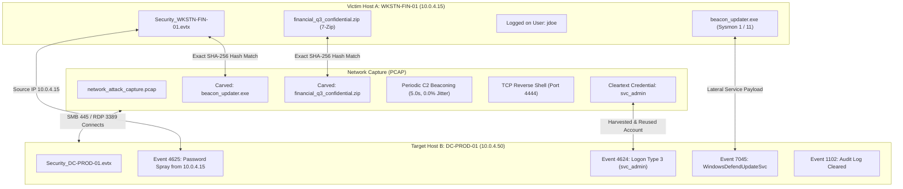

# Operation CobaltShadow: Multi-Artifact Hacker Attack Scenario

A realistic, correlated multi-file forensic investigation scenario specifically crafted to demonstrate FileSanitizer's advanced multi-file correlation, threat graph topology, and forensic telemetry analysis.

---

## 📁 Artifact Inventory

| Filename | Type | Host Role | Description |
| :--- | :--- | :--- | :--- |
| **`network_attack_capture.pcap`** | PCAP Capture | Network Tap / Host A (`10.0.4.15`) | Network traffic recording initial C2 payload staging, 0%-jitter beaconing, interactive reverse shell terminal session, cleartext credential interception, and multi-part data exfiltration. |
| **`Security_WKSTN-FIN-01.evtx`** | Windows Event Log | Endpoint Host A (`WKSTN-FIN-01`) | Finance workstation security log recording AMSI bypass, PowerShell payload download, binary creation, LSASS memory access, and 7-Zip exfiltration staging. |
| **`Security_DC-PROD-01.evtx`** | Windows Event Log | Domain Controller Host B (`DC-PROD-01`) | Domain Controller security log recording horizontal password spraying from Host A, lateral authentication (Logon Type 3), privilege escalation (`SeDebugPrivilege`), remote service creation (`WindowsDefendUpdateSvc`), ransomware volume shadow deletion, and audit log wiping. |

---

## 🔗 Cross-Artifact Bindings & Indicators of Compromise (IOCs)



### 1. Cryptographic File Hash Overlaps
* **Primary Malware Implant (`beacon_updater.exe`)**:
  * **SHA-256**: `b002241ff8da0fd372dc9736bf2e4be970fb89792d6df5fac28de3eaa5b4f982`
  * **MD5**: `4ffdc2a3c88a8396fdf1367eec6d2a8b`
  * **Cross-File Bindings**:
    1. `network_attack_capture.pcap`: Downloaded via HTTP 200 GET `/beacon_updater.exe` from `evil-payloads-delivery.org` and carved by FileSanitizer's PCAP analyzer.
    2. `Security_WKSTN-FIN-01.evtx`: Recorded under Sysmon Event 11 (File Creation) and Event 4688 (Process Execution).
    3. `Security_DC-PROD-01.evtx`: Installed remotely as service payload under Event 7045 (`WindowsDefendUpdateSvc`) and executed via Event 4688.

* **Exfiltrated Financial Archive (`financial_q3_confidential.zip`)**:
  * **SHA-256**: `2f38219c4605e94329c4b2dfd086b0af17e0c131b0d2edf30416d8d0ec3c2bf0`
  * **MD5**: `4c35089de860e4b79f9c3adbd5c1f41f`
  * **Cross-File Bindings**:
    1. `network_attack_capture.pcap`: Exfiltrated via multipart HTTP POST to `dropzone-secure-exfil.com` and carved with exact matching hashes.
    2. `Security_WKSTN-FIN-01.evtx`: Staged using 7-Zip (Event 4688) and written to disk under Sysmon Event 11.

---

### 2. Network Infrastructure & Geolocation
* **Victim Workstation**: `10.0.4.15` (Host A: `WKSTN-FIN-01.target.local`)
* **Target Domain Controller**: `10.0.4.50` (Host B: `DC-PROD-01.target.local`)
* **Attacker C2 Infrastructure**:
  * **C2 Server IP**: `185.220.101.45`
  * **C2 Domain**: `evil-payloads-delivery.org` / `c2.evil-payloads-delivery.org`
  * **Beaconing Signature**: 8 pulses every 5.0 seconds with **0.0% jitter**, triggering FileSanitizer's critical C2 beaconing detector.
* **Interactive Reverse Shell Listener**:
  * **Attacker Listener IP**: `194.26.29.112:4444` (Port 4444 recognized as TCP Reverse Shell, fully reconstructed with terminal commands and session dialogue).
* **Exfiltration Dropzone**:
  * **Exfiltration IP**: `91.240.118.72`
  * **Exfiltration Domain**: `dropzone-secure-exfil.com`

---

### 3. Compromised Identities & Credential Reuse
* **`jdoe`**: Finance analyst on Host A whose session is compromised initially.
* **`svc_admin`**: Privileged domain service account:
  * Intercepted in cleartext HTTP POST on `network_attack_capture.pcap` (`username=svc_admin&password=P%40ssw0rd2026%21Summer%23`).
  * Used on Host A via Event 4648 (`Logon with Explicit Credentials`).
  * Authenticated remotely against Host B (`DC-PROD-01`) via Event 4624 (Logon Type 3 Network Logon from `10.0.4.15`).
  * Granted `SeDebugPrivilege` via Event 4672 on Host B.
* **Sprayed Accounts**: `backup_admin`, `sql_svc`, `adm_john` targeted in distributed failed logons (Event 4625) originating from `10.0.4.15`.

---

## ⏱️ Unified Chronological Timeline of Attack Campaign

```
2026-10-10 10:00:00 UTC | [WKSTN-FIN-01] Event 4624: Interactive logon by user 'jdoe'
2026-10-10 10:00:01 UTC | [PCAP Capture] Google search for AMSI bypass & download cradles
2026-10-10 10:00:05 UTC | [WKSTN-FIN-01] Sysmon 22: DNS query for 'evil-payloads-delivery.org'
2026-10-10 10:00:07 UTC | [PCAP Capture] HTTP GET /beacon_updater.exe from 185.220.101.45:80
2026-10-10 10:00:08 UTC | [WKSTN-FIN-01] Sysmon 11: File creation for beacon_updater.exe
2026-10-10 10:00:10 UTC | [WKSTN-FIN-01] Event 4688: Process execution of beacon_updater.exe
2026-10-10 10:00:12 UTC | [WKSTN-FIN-01] Event 4104: Malicious PowerShell AMSI bypass script block
2026-10-10 10:00:15 UTC | [WKSTN-FIN-01] Sysmon 3: Outbound connection to C2 185.220.101.45:443
2026-10-10 10:00:17 UTC | [PCAP Capture] C2 Heartbeat Beaconing begins (5.0s pulse interval)
2026-10-10 10:00:22 UTC | [PCAP Capture] Cleartext credential interception (svc_admin logon)
2026-10-10 10:00:25 UTC | [WKSTN-FIN-01] Sysmon 10: ProcessAccess handle to lsass.exe (GrantedAccess 0x1010)
2026-10-10 10:00:28 UTC | [PCAP Capture] Reverse shell session on port 4444 (whoami, net user /domain, lsass)
2026-10-10 10:00:30 UTC | [DC-PROD-01]   Event 4625: Password spray failed logon for 'backup_admin' from 10.0.4.15
2026-10-10 10:00:32 UTC | [DC-PROD-01]   Event 4625: Password spray failed logon for 'sql_svc' from 10.0.4.15
2026-10-10 10:00:34 UTC | [DC-PROD-01]   Event 4625: Password spray failed logon for 'adm_john' from 10.0.4.15
2026-10-10 10:00:36 UTC | [WKSTN-FIN-01] Event 4648: Explicit logon initiated targeting DC-PROD-01
2026-10-10 10:00:38 UTC | [DC-PROD-01]   Event 4624: Successful Network Logon (Type 3) by 'svc_admin' from 10.0.4.15
2026-10-10 10:00:39 UTC | [DC-PROD-01]   Event 4672: Special privileges (SeDebugPrivilege) granted to 'svc_admin'
2026-10-10 10:00:41 UTC | [DC-PROD-01]   Event 5145: SMB admin share access (\\*\ADMIN$\System32\beacon_updater.exe)
2026-10-10 10:00:45 UTC | [DC-PROD-01]   Event 7045: New service installed: 'WindowsDefendUpdateSvc'
2026-10-10 10:00:50 UTC | [DC-PROD-01]   Event 4688: Service execution of beacon_updater.exe --service
2026-10-10 10:00:58 UTC | [WKSTN-FIN-01] Event 4688: 7-Zip staging financial_q3_confidential.zip
2026-10-10 10:01:00 UTC | [WKSTN-FIN-01] Sysmon 11: File creation for financial_q3_confidential.zip
2026-10-10 10:01:20 UTC | [DC-PROD-01]   Event 4688: vssadmin delete shadows /all /quiet
2026-10-10 10:01:22 UTC | [DC-PROD-01]   Event 4688: bcdedit /set {default} recoveryenabled No
2026-10-10 10:01:30 UTC | [DC-PROD-01]   Event 1102: CRITICAL Security audit log cleared by Administrator
```

---

## 🚀 How to Test in FileSanitizer

1. Launch FileSanitizer (`docker compose up -d`) and open `http://localhost:3000`.
2. Drag and drop all 3 files from `test-files/attack_scenario/` simultaneously into the upload zone:
   * `network_attack_capture.pcap`
   * `Security_WKSTN-FIN-01.evtx`
   * `Security_DC-PROD-01.evtx`
3. Click the **Relationship Mapping** tab in the workspace bar.
4. Explore the synchronized views:
   * **Campaign Graph**: View connected host nodes (`WKSTN-FIN-01`, `DC-PROD-01`), C2 IPs, and carved files.
   * **Unified Timeline**: View all 41 chronologically ordered events spanning PCAP network actions and both Windows host event logs.
   * **Fleet Forensics**: View the multi-host comparison matrix, high-confidence lateral movement chain (`WKSTN-FIN-01 -> DC-PROD-01 via WindowsDefendUpdateSvc`), and password spray detection.
   * **PCAP Network Intelligence**: Inspect terminal session replay (port 4444 dialogue), carved files, and 0%-jitter beaconing detection.
