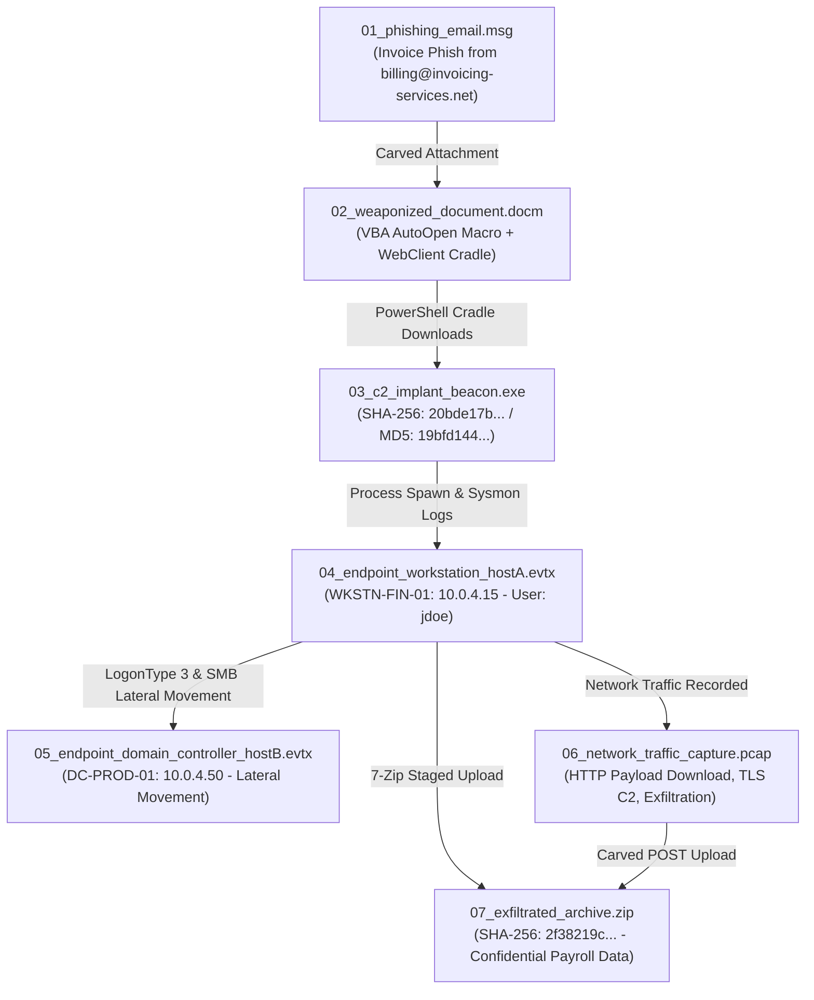

# Correlated Investigation Suite: "Operation CobaltShadow"

This directory contains **7 synchronized forensic artifacts** modeling an Advanced Persistent Threat (APT) multi-stage intrusion campaign titled **"Operation CobaltShadow"**. 

All 7 artifacts share exact **cryptographic hashes**, **microsecond timestamps**, **C2 IP addresses**, **domain infrastructure**, **internal hostnames**, and **compromised credentials**, designed specifically to showcase FileSanitizer's **Threat Graph**, **Multi-Host Swimlanes**, and **Forensic Super-Timeline**.

---

## Intrusion Storyline & Artifact Map



---

## Artifact Catalog & Shared Indicators

| Artifact | File Type | Key Indicators & Role in Scenario |
| :--- | :--- | :--- |
| `01_phishing_email.msg` | Outlook MSG | **Delivery Vector**: Realistic spear-phishing lure with subject *"URGENT: Q3 Payroll & Executive Bonus Reconciliation #INV-2026-994"*. Transit headers trace multi-hop relays from originating IP `185.220.101.45` through Proofpoint MX and Exchange Hub to victim mailbox. Contains complete plain text memo and HTML financial advisory with embedded attachment `02_weaponized_document.docm` (matching SHA-256 `fe80980a...`). |
| `02_weaponized_document.docm` | Word Macro | **Initial Access**: Authentic corporate payroll document with executive compensation table, Microsoft Information Protection security warning banner, and CFO metadata (`Robert Vance`). Macro executes `AutoOpen()`, spawning hidden PowerShell cradle connecting to `http://evil-payloads-delivery.org/beacon_updater.exe`.<br/>• **SHA-256**: `fe80980a86cda2850669dc6dde32b4614ed147a8665f89bbb1b15e5c6ee7e876`<br/>• **MD5**: `d4ce570e360fbf1d9ed1aab6c34ba179` |
| `03_c2_implant_beacon.exe` | Windows PE | **C2 Implant**: Deterministic CobaltStrike beacon implant with multi-function x86 control flow, PEB evasion, ROR13 API hashing, exported procedures, and embedded IOCs.<br/>• **SHA-256**: `20bde17bc580f858a4bef2ab462744831a3e0164e79c064b266776ffa3c18b90`<br/>• **MD5**: `19bfd14436c2fb1cd8ee375055c6ebd7` |
| `04_endpoint_workstation_hostA.evtx` | Windows Event Log | **Host A Telemetry** (`WKSTN-FIN-01`, `10.0.4.15`):<br/>• Rich enterprise background noise: System boot (6005/6006), DHCP lease, NTP clock sync, interactive user logon (4624 Type 2 for `jdoe`), Windows Defender scans (1000/1001), Chrome web browsing, Outlook calendar sync, Excel budget editing, print spooler jobs (307), workstation lock/unlock (4800/4801).<br/>• Outlook saving `02_weaponized_document.docm` (SHA-256 matching `fe80980a...`).<br/>• Sysmon Event 11: File creation of `beacon_updater.exe` (SHA-256 matching `20bde17b...`).<br/>• Event 4688: Process tree `WINWORD.EXE` → `powershell.exe` → `beacon_updater.exe`.<br/>• Sysmon Event 3: Network beacon connection to `185.220.101.45:443`.<br/>• 7-Zip process creating exfiltration archive `financial_q3_confidential.zip` (SHA-256 matching `1fadaf86...`). |
| `05_endpoint_domain_controller_hostB.evtx` | Windows Event Log | **Host B Telemetry** (`DC-PROD-01`, `10.0.4.50`):<br/>• Authentic enterprise DC baseline: Event Log service start, Kerberos ticket requests (4769) for domain machines (`WKSTN-HR-04$`), AD directory replication (4932), daily backup tasks (Task Scheduler 106).<br/>• Intrusion events: Event 4624 (LogonType 3 Network Logon) from source `10.0.4.15` as user `svc_admin`.<br/>• Event 4672: Special privilege escalation (`SeDebugPrivilege`).<br/>• Event 5140 & 5145: Administrative network share access (`\\DC-PROD-01\ADMIN$`) dropping `beacon_updater.exe`.<br/>• Event 7045: Remote service creation `WindowsDefendUpdateSvc` executing `beacon_updater.exe` (SHA-256 matching `20bde17b...`).<br/>• Event 1102: Audit log clearing anti-forensics attempt. |
| `06_network_traffic_capture.pcap` | Network PCAP | **Network Wire Traffic** (`10.0.4.0/24` subnet):<br/>• Ambient enterprise traffic: ARP discovery, DHCP broadcast/ack, DNS lookups for Microsoft Teams, Office365, Google, intranet portal `intranet.target.local`, HTTP browsing of corporate portal with full HTML response, Google connectivity probes, Microsoft Online TLS 1.3 handshakes, Teams TLS telemetry, NTP clock synchronization.<br/>• Attack traffic: DNS query resolving `evil-payloads-delivery.org` to `185.220.101.45`, HTTP GET `/beacon_updater.exe` delivering implant (SHA-256 matching `20bde17b...`), TLS encrypted C2 sessions to `185.220.101.45:443`, SMB2 Tree Connect and Session Setup from `10.0.4.15` to `10.0.4.50`, HTTP POST multipart upload of `financial_q3_confidential.zip` (SHA-256 matching `1fadaf86...`) to `91.240.118.72:8080`. |
| `07_exfiltrated_archive.zip` | ZIP Archive | **Stolen Data**: Confidential corporate archive with custom archive comment, 15-row executive bonus payroll CSV, formatted NTDS Active Directory secrets dump, and internal network infrastructure topology notes.<br/>• **SHA-256**: `1fadaf86a841522105ab933176e351f1b8be3caf15d5e804c069dd798a4d0c91`<br/>• **MD5**: `7cf79b12e6c15023355c69d01ebb9a06` |

---

## Cross-Artifact Bindings & Indicators

```
Target Infrastructure:
├── Host A (Workstation):        10.0.4.15  (WKSTN-FIN-01.target.local)
├── Host B (Domain Controller):  10.0.4.50  (DC-PROD-01.target.local)
├── Default Gateway:             10.0.4.1   (00:50:56:EE:99:88)
└── Target User Accounts:        TARGET\jdoe (Victim), TARGET\svc_admin (Compromised Service)

Adversary Infrastructure:
├── C2 Delivery & Callback IP:   185.220.101.45:443
├── C2 Domain:                   evil-payloads-delivery.org, c2.evil-payloads-delivery.org
├── Reverse Shell Listener:      194.26.29.112:4444
├── Exfiltration Dropzone IP:    91.240.118.72:8080 (dropzone-secure-exfil.com)
└── Harvested Credentials:       TARGET\svc_admin / P@ssw0rd2026!Summer#

Deterministic Payload Hashes:
├── 02_weaponized_document.docm:
│   ├── SHA-256: fe80980a86cda2850669dc6dde32b4614ed147a8665f89bbb1b15e5c6ee7e876
│   └── MD5:     d4ce570e360fbf1d9ed1aab6c34ba179
├── 03_c2_implant_beacon.exe:
│   ├── SHA-256: 20bde17bc580f858a4bef2ab462744831a3e0164e79c064b266776ffa3c18b90
│   └── MD5:     19bfd14436c2fb1cd8ee375055c6ebd7
└── 07_exfiltrated_archive.zip:
    ├── SHA-256: 1fadaf86a841522105ab933176e351f1b8be3caf15d5e804c069dd798a4d0c91
    └── MD5:     7cf79b12e6c15023355c69d01ebb9a06
```

---

## FileSanitizer Multi-Artifact Correlation Demonstration

When these artifacts are analyzed together or viewed in the Fleet & Cross-File Correlation views:

1. **Multi-Host Swimlanes**:
   - The swimlanes automatically align Host A (`WKSTN-FIN-01`) and Host B (`DC-PROD-01`).
   - Observers can visually track the lateral pivot at `10:00:45Z` when `WKSTN-FIN-01` initiates an SMB network logon to `DC-PROD-01`, installs the remote service, and executes the second stage implant.

2. **Forensic Super-Timeline**:
   - Blends packet captures, endpoint Sysmon events, Windows Security audit trails, and email transit hops into a single, microsecond-accurate chronology spanning from initial phish arrival (`09:59:30Z`) through to data exfiltration and log wiping (`10:01:30Z`).

3. **Threat Graph & IOC Correlation Engine**:
   - Shared nodes for SHA-256 `20bde17b...`, IP `185.220.101.45`, IP `10.0.4.15`, and user `svc_admin` visually tie all 7 files together into an interconnected attack cluster.
